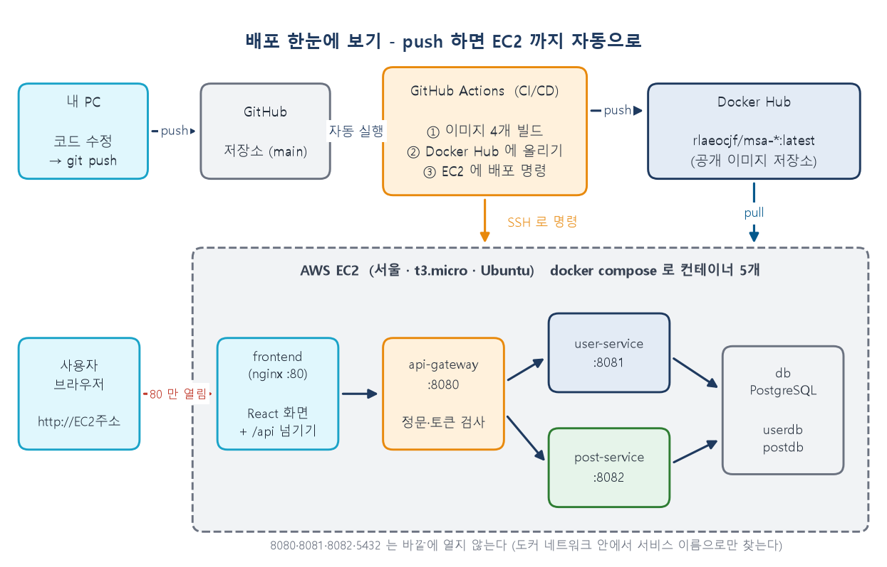

# 0장. 과정 안내

## 배포 한눈에 보기

MSA 기초 과정에서 만든 **로그인 게시판**은 지금 내 PC 에서만 돌아간다. 이 교안에서는 이 게시판을 **인터넷 어디서나 접속할 수 있는 서버**에 올린다. 그리고 코드를 고쳐 `git push` 하면 **서버까지 저절로 바뀌게(자동 배포)** 만든다. 먼저 완성된 모습을 그림 한 장으로 보자.



그림을 위에서 아래로 따라가 보자.

1. **내 PC** 에서 코드를 고치고 `git push` 한다.
2. **GitHub Actions** 가 push 를 알아채고 자동으로 일을 시작한다. 서비스 4개(user-service, post-service, api-gateway, frontend)를 **Docker 이미지**로 만든다.
3. 만든 이미지를 **Docker Hub**(이미지를 올려 두는 인터넷 창고)에 올린다.
4. GitHub Actions 가 **AWS EC2**(아마존이 빌려주는 인터넷 컴퓨터)에 SSH 로 접속해서 "새 이미지를 받아 다시 켜라" 고 명령한다.
5. 사용자는 브라우저로 `http://EC2주소` 에 접속한다. 바깥에 열린 문은 **80번 포트(nginx) 하나뿐**이다.

> **[배포 개념] 이 교안에서 배우는 네 가지**
>
> ① **이미지로 만들기 (Docker)**: 프로그램과 실행 환경을 꾸러미 하나로 묶는다. 어느 컴퓨터에서나 똑같이 돈다.
>
> ② **이미지 창고 (Docker Hub)**: 만든 이미지를 올려 두면 서버는 소스 코드 없이 이미지만 받아서 실행한다.
>
> ③ **클라우드 서버 (AWS EC2)**: 24시간 켜져 있고 공인 IP 가 있는 컴퓨터를 빌린다.
>
> ④ **자동 배포 (CI/CD, GitHub Actions)**: push 하면 빌드 → 업로드 → 배포 → 확인까지 사람 손 없이 이어진다.

## 무엇을 배포하나

배포할 앱은 [react-spring-mas-postgresql](https://github.com/sinaboro/react-spring-mas-postgresql) **기초 과정**의 완성 코드다. 이 저장소에 그 코드를 그대로 옮겨 왔고, 배포에 필요한 몇 곳만 고쳤다.

| | MSA 기초 과정 (내 PC) | 이 교안 (EC2) |
|---|---|---|
| 실행 방법 | IntelliJ 에서 서비스 3개 ▶, `npm run dev` | `docker compose up -d` 한 줄 |
| 화면 주소 | `http://localhost:5173` | `http://EC2공인IP` (80번) |
| React 가 부르는 API | `http://localhost:8080/api` | `/api` (nginx 가 게이트웨이로 넘김) |
| DB 비밀번호·JWT 열쇠 | 코드 속 기본값 | GitHub Secrets → 서버의 `.env` |
| 코드를 고치면 | 다시 실행 | `git push` → 자동 배포 |

> **Kafka 를 쓰는 심화 과정은 배포하지 않는다.** 무료 EC2(t3.micro)는 메모리가 1GB 뿐이라, 서비스 3개 + DB 만으로도 거의 꽉 찬다. 기초 과정만으로도 배포의 흐름은 모두 익힐 수 있다.

## 진행 순서 (권장 8시간)

| 장 | 내용 | 시간 |
|---|---|---|
| 0장 | 과정 안내, 계정 준비 | 0.5 |
| 1장 | 배포를 위해 바꾼 코드 - `localhost` 를 버리고 `/api` 로 | 0.5 |
| 2장 | Docker 이미지 만들기 - Dockerfile 과 내 PC 에서 운영처럼 실행 | 1.5 |
| 3장 | Docker Hub 에 이미지 올리기 | 0.5 |
| 4장 | AWS EC2 만들기 (화면 따라 하기) | 1 |
| 5장 | 서버 준비와 첫 배포 - SSH, Docker 설치, 손으로 배포 | 1.5 |
| 6장 | GitHub Actions - 비밀 값 넣기와 워크플로 읽기 | 1 |
| 7장 | 자동 배포 확인 - push 하면 서버가 바뀐다 | 1 |
| 8장 | 정리와 삭제 - 요금이 나가지 않게 | 0.5 |

장마다 **개념 → 따라 하기 → 확인 → 확인 문제** 순서다. 확인 문제 풀이는 부록 B, 자주 나는 오류는 부록 A 에 있다. 본문 곳곳의 **[배포 개념]** 상자는 그 작업이 왜 필요한지 설명한다.

## 0-1. 준비

**설치할 프로그램** - MSA 기초 과정과 같다. 이번에는 JDK·Node.js 가 없어도 된다. (빌드는 Docker 안에서 한다)

- **Docker Desktop** (실행해 두기), **Git**, VS Code
- Windows 10/11 에 들어 있는 **OpenSSH** (`ssh`, `scp` 명령). PowerShell 에서 `ssh -V` 로 확인한다.

**만들어 둘 계정** - 셋 다 무료로 만들 수 있다.

| 계정 | 쓰는 곳 | 주의 |
|---|---|---|
| GitHub | 코드 저장소, GitHub Actions | 공개(public) 저장소면 Actions 가 무료 |
| Docker Hub | 이미지 창고 (https://hub.docker.com) | 공개 저장소는 무료. 사용자 이름을 기억해 둔다 |
| AWS | EC2 서버 (https://aws.amazon.com) | 가입할 때 **신용카드**가 필요하다. 8장에서 꼭 지운다 |

> **요금 이야기 먼저.** 이 교안의 EC2(t3.micro, 서울)는 켜 둔 시간만큼 요금이 붙는다(약 시간당 0.013 달러 + 공인 IP 0.005 달러, 한 달 내내 켜 두면 약 13 달러, 2만 원 안팎). AWS 신규 계정은 프리 티어·무료 크레딧으로 처리되는 경우가 많지만, **실습이 끝나면 8장대로 인스턴스를 지우는 것**이 가장 확실한 절약이다.

**[PS]** 저장소 받기 - 자기 GitHub 로 **Fork** 한 뒤 받는다 (Actions 와 Secrets 는 자기 저장소에서만 설정할 수 있다)

```powershell
cd C:\study
git clone https://github.com/<내GitHub아이디>/react-spring-msa-deploy.git
cd react-spring-msa-deploy
```

**폴더 구성**

```text
react-spring-msa-deploy/
├─ backend/                     MSA 기초 과정 서비스 3개
│   ├─ Dockerfile                 서비스 하나를 골라 이미지로 굽는 공용 파일 (2장)
│   ├─ api-gateway/  user-service/  post-service/
├─ frontend/                    React
│   ├─ Dockerfile                 빌드 → nginx 이미지 (2장)
│   └─ nginx.conf                 /api 는 게이트웨이로, 나머지는 React 로 (1장)
├─ db/init.sql                  userdb, postdb 만들기
├─ docker-compose.yml           내 PC 에서 빌드해서 운영처럼 실행 (2장)
├─ deploy/docker-compose.prod.yml   EC2 에서 Docker Hub 이미지를 받아 실행 (5장)
└─ .github/workflows/deploy.yml     push → 빌드 → Docker Hub → EC2 배포 (6장)
```

> **교안 속 값은 모두 예시다.** Docker Hub 사용자 이름 `rlaeocjf`, EC2 주소 `3.35.37.211` 같은 값은 강사가 교안을 만들 때 쓴 것이다. 따라 할 때는 **내 사용자 이름, 내 EC2 주소**로 바꿔 넣는다. 화면 캡처에서 AWS 계정 정보는 가렸다.

## 0-2. 이 교안의 표시

- **[PS]** 표시 아래 명령은 **내 PC 의 PowerShell** 에서 친다.
- **[EC2]** 표시 아래 명령은 `ssh` 로 접속한 **EC2 서버의 터미널**(`ubuntu@ip-...:~$`)에서 친다. 둘을 헷갈리면 "명령을 찾을 수 없다" 는 오류가 난다.
- `<내GitHub아이디>` 처럼 `< >` 로 감싼 곳은 내 값으로 바꾼다. `< >` 기호는 지운다.

## 확인 문제

1. 이 교안에서 서버(EC2)는 소스 코드를 받아서 빌드할까, 이미지를 받아서 실행할까?
2. 바깥(인터넷)에 열리는 포트는 몇 번 하나뿐인가? 그 포트에서 일하는 프로그램은?
3. 심화 과정(Kafka)을 배포하지 않는 까닭은?
