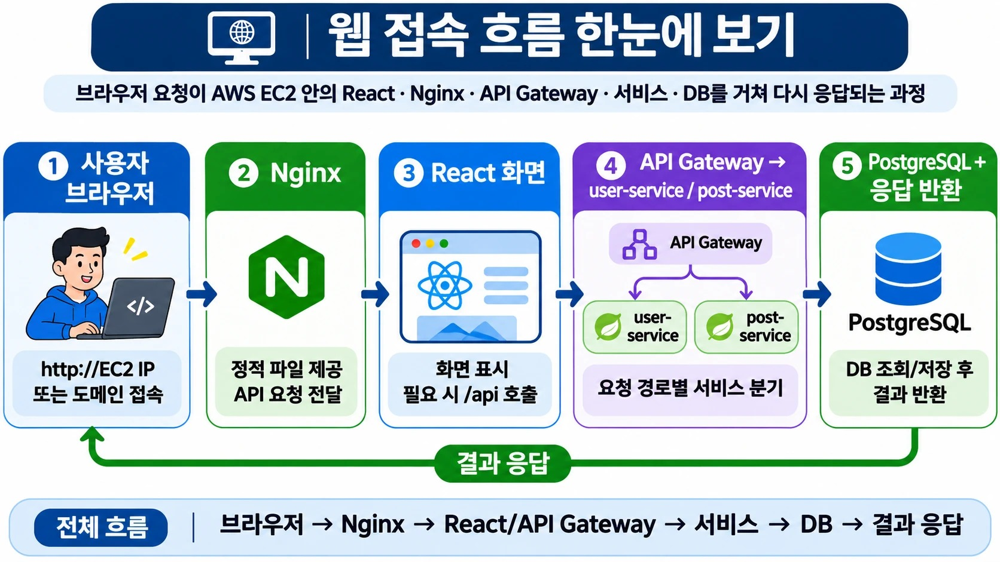

# 1장. 배포를 위해 바꾼 코드

## 학습 목표

- 서버에서는 왜 `http://localhost:8080` 을 쓸 수 없는지 설명한다.
- **nginx** 가 "화면" 과 "API" 를 한 주소(80번)에서 나눠 주는 방법을 이해한다.
- Nginx 가 무엇인지, **왜 꼭 앞에 두는지**, API Gateway 와는 무엇이 다른지 설명한다.
- 비밀 값(DB 비밀번호, JWT 열쇠)을 코드에서 빼서 **환경 변수**로 넣는 까닭을 안다.

## 1-1. localhost 의 함정

MSA 기초 과정의 React 는 API 를 이렇게 불렀다.

```javascript
export const API_URL = "http://localhost:8080/api";
```

내 PC 에서는 아무 문제가 없었다. 브라우저도, 게이트웨이도 **같은 PC** 에 있었기 때문이다. 그런데 이 React 를 EC2 에 올리면 어떻게 될까?

1. 사용자가 집에서 `http://3.35.37.211` 에 접속한다. 화면(HTML·JS)은 EC2 에서 받아 온다.
2. 화면 속 자바스크립트는 **사용자의 브라우저에서** 실행된다.
3. 그 자바스크립트가 `http://localhost:8080/api/posts` 를 부른다. 여기서 `localhost` 는 **사용자 자신의 PC** 다.
4. 사용자 PC 에는 게이트웨이가 없다 → 연결 실패. 글 목록이 비어 보인다.

> **[배포 개념] React 코드는 서버가 아니라 브라우저에서 돈다.** 그래서 React 코드 안의 `localhost` 는 "서버" 가 아니라 "그 화면을 연 사람의 PC" 를 가리킨다. 배포할 때 가장 많이 하는 실수다.

## 1-2. 해결: 주소를 `/api` 로, 길 안내는 nginx 가

이 저장소에서 React 코드는 **딱 한 줄** 바꿨다.

```javascript
// frontend/src/api.js (일부)
export const API_URL = "/api";
```

`/api` 처럼 `http://` 없이 `/` 로 시작하면 브라우저는 **"지금 이 화면을 받아 온 바로 그 서버"** 에 요청한다. 화면을 `http://3.35.37.211` 에서 받았으면 `http://3.35.37.211/api/posts` 로 간다. 내 PC 에서 `http://localhost` 로 열었으면 `http://localhost/api/posts` 로 간다. 주소를 코드에 적지 않으니 **어느 서버에 올려도 그대로** 돈다.

그럼 80번 포트로 들어온 `/api/...` 요청을 누가 게이트웨이(8080)로 넘겨줄까? **nginx** 다. frontend 이미지 안에서 React 빌드 결과를 내려주는 웹 서버이고, 다음 설정 파일 하나로 두 가지 일을 한다.

<!-- file: frontend/nginx.conf -->

```nginx
# nginx.conf - 운영 서버의 "정문" 설정 (frontend 이미지 안에 들어간다)
#
# 브라우저 ──▶ nginx (80번 포트, 바깥에 열린 유일한 문)
#               ├─ /api/...  → api-gateway:8080 으로 넘긴다 (게이트웨이가 다시 user/post-service 로)
#               └─ 그 밖     → React 빌드 결과(index.html, js, css)를 내려준다
#
# api-gateway, user-service, post-service, db 는 바깥에 포트를 열지 않는다.
# 같은 도커 네트워크 안에서 "서비스 이름" (api-gateway) 으로만 찾아간다.

server {
    listen 80;

    # React 빌드 결과가 있는 곳 (frontend/Dockerfile 에서 복사해 넣는다)
    root /usr/share/nginx/html;
    index index.html;

    # 1) API 요청은 게이트웨이로
    location /api/ {
        proxy_pass http://api-gateway:8080;              # 도커 compose 의 서비스 이름으로 찾아간다
        proxy_set_header Host $host;
        proxy_set_header X-Real-IP $remote_addr;
        proxy_set_header X-Forwarded-For $proxy_add_x_forwarded_for;
    }

    # 2) 화면 요청은 React 로
    #    /posts/3 처럼 React Router 가 쓰는 주소는 실제 파일이 없다.
    #    그럴 때 index.html 을 주면 React Router 가 주소를 보고 맞는 화면을 그린다. (새로 고침해도 404 가 나지 않게)
    location / {
        try_files $uri $uri/ /index.html;
    }
}
```

| 요청 주소 | nginx 가 하는 일 |
|---|---|
| `/` , `/assets/index-abc.js` | React 빌드 파일을 그대로 내려준다 |
| `/posts/3` (파일이 없는 주소) | `index.html` 을 준다 → React Router 가 3번 글 화면을 그린다 |
| `/api/posts` | `http://api-gateway:8080/api/posts` 로 넘긴다 (프록시) |

> **[배포 개념] 리버스 프록시(reverse proxy)** - 바깥 요청을 대신 받아서 안쪽 서버로 넘겨주는 문지기. 덕분에 바깥에는 80번 하나만 열고, 게이트웨이(8080)·서비스(8081, 8082)·DB(5432)는 **인터넷에서 보이지 않게** 숨길 수 있다.

> **CORS 걱정도 사라진다.** 화면과 API 가 같은 주소(같은 출처)에서 오므로 브라우저가 CORS 검사를 하지 않는다. 게이트웨이의 CORS 설정은 개발할 때(5173 → 8080)만 쓰인다.

## 1-3. Nginx 는 무엇이고, 왜 꼭 있어야 하나

### Nginx 한 줄 정의

**Nginx(엔진엑스)** 는 **웹 서버**이면서 **리버스 프록시**다. 전 세계 웹사이트의 상당수가 맨 앞에 Nginx 를 둘 만큼 흔한 프로그램이고, 아주 가볍다(이 교안의 frontend 컨테이너는 메모리를 수 MB 만 쓴다).

| 역할 | 뜻 | 이 교안에서 |
|---|---|---|
| **웹 서버** | 요청받은 **파일**을 그대로 내려준다 | React 빌드 결과(`index.html`, JS, CSS) 를 브라우저에 준다 |
| **리버스 프록시** | 요청을 대신 받아 **안쪽 서버로 넘기고**, 받은 답을 다시 돌려준다 | `/api/...` 요청을 `api-gateway:8080` 으로 넘긴다 |

먼저 브라우저의 요청 하나가 어떤 길을 지나는지 그림으로 보자.



> 그림의 ③ "React 화면" 은 **Nginx 가 브라우저에 건네준 파일이 브라우저 안에서 실행된 것**이다. React 가 EC2 안에서 따로 돌고 있는 것이 아니다(1-1). 그 화면이 다시 `/api/...` 를 부르면 그 요청도 **다시 Nginx 로 들어와** ④ API Gateway 로 넘어간다.

### Nginx 가 없으면 어떻게 될까

"React 는 `npm run dev` 로, 서버는 8080 으로 그냥 열면 되지 않나?" 하고 생각할 수 있다. 하나씩 따져 보자.

| 문제 | Nginx 없이 | Nginx 를 앞에 두면 |
|---|---|---|
| **① React 를 누가 내려주나** | `npm run dev` 는 **개발용** 서버다. 소스를 그때그때 변환하느라 느리고, 서버에 Node.js·소스 코드가 다 있어야 하며, 운영에 쓰지 말라고 Vite 가 직접 안내한다 | `npm run build` 로 만든 **완성 파일**만 Nginx 가 빠르게 내려준다. 서버에는 Node.js 도 소스도 필요 없다 (2장 frontend 이미지 약 90MB) |
| **② 주소가 둘로 갈린다** | 화면은 `:5173`, API 는 `:8080`. React 코드에 서버 주소를 적어야 하고, 출처가 달라 **CORS** 설정이 필요하다 | 화면과 API 가 같은 `http://EC2주소` 하나에서 나온다. React 는 `/api` 만 쓰면 되고 CORS 가 필요 없다 (1-2) |
| **③ 안쪽이 다 드러난다** | 8080(게이트웨이)을 인터넷에 열어야 하고, 실수로 8081·8082·5432 까지 열기 쉽다 | 바깥에는 **80 하나만** 연다. 게이트웨이·서비스·DB 는 도커 네트워크 안에 숨는다 (보안 그룹도 22·80 만) |
| **④ 새로 고침하면 404** | `/posts/3` 에서 F5 를 누르면 그런 **파일**이 없어 404 | `try_files ... /index.html` 한 줄로 React Router 가 화면을 그리게 한다 |
| **⑤ 나중에 할 일** | HTTPS 인증서, 압축, 캐시, 접속 기록을 서비스마다 따로 만들어야 한다 | 이런 일을 **정문 한 곳(Nginx)** 에서 처리한다 (8장 더 나아가기: HTTPS) |

> **[배포 개념] "정적 파일" 과 "동적 응답"** - React 빌드 결과는 누가 요청해도 똑같은 **정적 파일**이다. 이런 파일은 Nginx 같은 웹 서버가 가장 빠르고 싸게 내려준다. 반면 글 목록·로그인처럼 요청마다 DB 를 보고 답이 달라지는 **동적 응답**은 Spring 서비스가 만든다. 그래서 "파일은 Nginx, 데이터는 Spring" 으로 일을 나눈다.

### API Gateway 도 "정문" 인데, 둘은 무엇이 다른가

MSA 기초 과정에서 API Gateway 를 "정문" 이라고 불렀다. Nginx 도 정문이다. 헷갈리기 쉬우니 비교해 두자. **문이 두 겹**이라고 생각하면 된다.

| | Nginx (바깥 문) | API Gateway (안쪽 문) |
|---|---|---|
| 서 있는 곳 | 인터넷과 맞닿은 맨 앞 (80번) | Nginx 뒤, 서비스들 앞 (8080, 바깥에서 안 보임) |
| 하는 일 | 화면 파일 내려주기, `/api` 를 게이트웨이로 넘기기 | 토큰 검사, `/api/auth` → user-service, `/api/posts` → post-service 로 길 안내, 서비스가 꺼지면 503 |
| 우리 앱을 아나 | 모른다. 주소 앞부분(`/api/`)만 보고 넘긴다 | 안다. 로그인·회원·글이라는 업무 규칙을 Spring 코드로 갖고 있다 |
| 만드는 방법 | 설정 파일 한 장 (`nginx.conf`) | Spring Cloud Gateway 코드 (MSA 기초 6장) |

```text
브라우저 ──▶ Nginx(:80) ──┬─ /, /assets/... ──▶ React 빌드 파일 (Nginx 가 직접 준다)
                          └─ /api/...       ──▶ API Gateway(:8080) ──┬─ /api/auth  ──▶ user-service ──▶ userdb
                                                                     └─ /api/posts ──▶ post-service ──▶ postdb
```

### 요청 세 개를 따라가 보기

브라우저로 `http://EC2주소` 를 열고 글 목록이 보일 때까지, 실제로 이런 요청이 오간다. (브라우저의 F12 → Network 탭에서 직접 볼 수 있다)

| 순서 | 브라우저가 보낸 요청 | Nginx 의 판단 (`nginx.conf`) | 결과 |
|---|---|---|---|
| ① | `GET /` | `/api/` 가 아니다 → `location /` → 파일 `index.html` | 빈 HTML 틀이 온다 |
| ② | `GET /assets/index-abc123.js` | 파일이 있다 → 그대로 내려준다 | React 코드가 브라우저에서 실행된다 |
| ③ | `GET /api/posts` (React 가 보냄) | `location /api/` → `proxy_pass http://api-gateway:8080` | 게이트웨이 → post-service → postdb → 글 목록 JSON |

**Nginx 는 어디에 있나?** 따로 설치하지 않는다. 2장의 `frontend/Dockerfile` 마지막 단계가 `FROM nginx:1.29-alpine` 이고, 거기에 React 빌드 결과와 `nginx.conf` 를 복사해 넣는다. 그래서 **frontend 컨테이너 = Nginx + React 빌드 파일**이다. compose 에서 `ports: "80:80"` 이 붙은 유일한 컨테이너가 바로 이것이다.

## 1-4. 개발할 때는 Vite 가 nginx 대신

`API_URL` 을 `/api` 로 바꾸면, 개발 서버(`npm run dev`, 5173)에서는 `http://localhost:5173/api/...` 로 요청이 간다. 5173 에는 게이트웨이가 없으므로 **Vite 개발 서버가 nginx 의 일을 대신** 하게 설정했다.

<!-- file: frontend/vite.config.js -->

```javascript
// vite.config.js - Vite(개발 서버·빌드 도구) 설정
//   plugins: [react()] → .jsx 파일의 JSX 를 브라우저가 이해하는 자바스크립트로 바꿔 준다.
//   개발 서버 주소는 기본값 http://localhost:5173
//
// [배포] server.proxy - 개발할 때(npm run dev)만 쓰이는 설정
//   React 가 "/api/posts" 로 요청하면 Vite 개발 서버가 대신 http://localhost:8080/api/posts (게이트웨이)로 보낸다.
//   운영(Docker)에서는 이 설정 대신 nginx 가 같은 일을 한다 (nginx.conf).
//   → 개발과 운영에서 React 코드(api.js 의 API_URL = "/api")가 똑같다.
import react from '@vitejs/plugin-react'
import { defineConfig } from 'vite'

export default defineConfig({
  plugins: [react()],
  server: {
    proxy: {
      '/api': 'http://localhost:8080',
    },
  },
})
```

| | 개발 (내 PC) | 운영 (Docker · EC2) |
|---|---|---|
| 화면을 주는 곳 | Vite 개발 서버 (5173) | nginx (80) |
| `/api` 를 넘기는 곳 | Vite `server.proxy` → `localhost:8080` | nginx `proxy_pass` → `api-gateway:8080` |
| React 코드 | `API_URL = "/api"` | 똑같다 |

## 1-5. 비밀 값은 환경 변수로

서비스의 `application.yml` 에는 DB 비밀번호와 JWT 열쇠가 이렇게 적혀 있다.

```yaml
# user-service/src/main/resources/application.yml (일부)
    url: ${DB_URL:jdbc:postgresql://localhost:5435/userdb}
    password: ${DB_PASSWORD:postgres}   # [배포] 운영에서는 환경 변수 DB_PASSWORD 로 넣는다
jwt:
  secret: ${JWT_SECRET:dev-only-secret-change-me-0123456789abcdef}
```

`${DB_PASSWORD:postgres}` 는 **"환경 변수 DB_PASSWORD 가 있으면 그 값, 없으면 postgres"** 라는 뜻이다.

- 내 PC 에서는 환경 변수가 없으니 기본값(`postgres`)으로 그냥 돈다. MSA 기초 과정과 똑같다.
- 서버에서는 Docker 가 컨테이너를 켤 때 진짜 비밀번호를 환경 변수로 넣어 준다. 그 값은 GitHub 저장소가 아니라 **GitHub Secrets** 에 둔다 (6장).

이 저장소에서 바꾼 것은 `DB_USERNAME`, `DB_PASSWORD` 두 줄이다. `DB_URL`, `JWT_SECRET` 은 원래부터 환경 변수로 받게 되어 있었다.

> **[배포 개념] 코드와 설정을 나눈다.** 같은 이미지를 내 PC, 시험 서버, 운영 서버에서 똑같이 쓰고, **다른 것은 환경 변수로만** 바꾼다. 비밀 값이 코드(GitHub)에 남지 않는 것도 큰 장점이다. 공개 저장소에 비밀번호를 올리면 몇 분 안에 자동 수집 프로그램이 찾아간다.

## 확인 문제

1. 서버에 올린 React 가 `http://localhost:8080/api` 를 부르면 왜 실패하나?
2. `/posts/3` 주소에서 새로 고침(F5)을 했을 때 nginx 가 `index.html` 을 주지 않으면 어떤 일이 생기나?
3. `${JWT_SECRET:dev-only-...}` 에서 콜론(`:`) 뒤의 값은 언제 쓰이나?
4. 운영 서버에서 React 를 `npm run dev` 로 띄우지 않고 Nginx 로 내려주는 까닭 두 가지는?
5. Nginx 와 API Gateway 는 둘 다 "정문" 이다. 각각 무엇을 보고 요청을 넘기는가?
