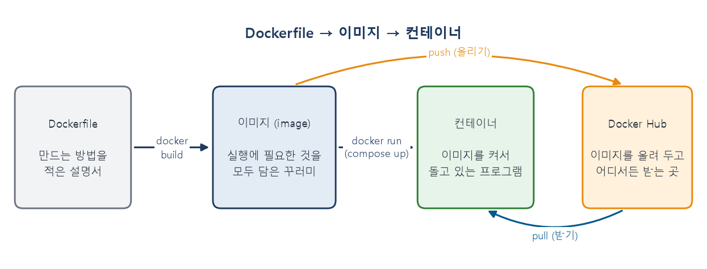
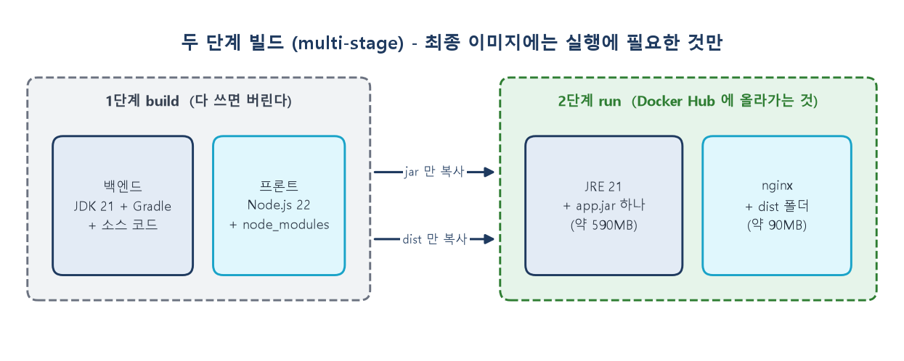

# 2장. Docker 이미지 만들기

## 학습 목표

- Dockerfile, 이미지, 컨테이너, 레지스트리(Docker Hub)의 관계를 설명한다.
- **두 단계 빌드(multi-stage)** 로 작은 이미지를 만드는 까닭을 안다.
- 내 PC 에서 `docker compose up -d --build` 로 **운영과 똑같이** 5개 컨테이너를 켜고 확인한다.

## 2-1. 이미지와 컨테이너

MSA 기초 과정에서도 Docker 를 썼다. PostgreSQL 을 `postgres:18` **이미지**로 받아 **컨테이너**로 켰다. 이번에는 우리 서비스 4개도 이미지로 만든다.



| 낱말 | 뜻 | 비유 |
|---|---|---|
| Dockerfile | 이미지를 만드는 순서를 적은 글자 파일 | 요리법 |
| 이미지 | 프로그램 + 실행에 필요한 것(Java, 설정)을 담은 꾸러미. 바뀌지 않는다 | 밀키트 |
| 컨테이너 | 이미지를 켜서 실제로 돌고 있는 프로그램 | 조리한 음식 |
| Docker Hub | 이미지를 올려 두고 어디서나 받는 창고 | 밀키트 창고 |

> **[배포 개념] "내 PC 에서는 되는데요?" 를 없앤다.** 서버에 Java 를 깔고, 버전을 맞추고, jar 를 복사하는 일을 사람이 하면 꼭 무언가 다르다. 이미지에는 Java 21 과 jar 가 함께 들어 있으니 **어느 컴퓨터에서 켜도 똑같이** 돈다. 서버에는 Docker 하나만 있으면 된다.

## 2-2. 백엔드 Dockerfile - 파일 하나로 서비스 3개

서비스 3개(api-gateway, user-service, post-service)는 모두 Spring Boot 이고 같은 Gradle 프로젝트(`backend/`) 안에 있다. 그래서 Dockerfile 도 **하나**만 만들고, 어느 서비스를 구울지는 빌드할 때 `SERVICE` 값으로 고른다.



<!-- file: backend/Dockerfile -->

```dockerfile
# Dockerfile (backend) - Spring Boot 서비스 하나를 이미지로 굽는다
#
# 서비스 3개(api-gateway, user-service, post-service)가 이 파일 하나를 함께 쓴다.
# 어느 서비스를 구울지는 빌드할 때 SERVICE 값으로 정한다.
#
#   docker build --build-arg SERVICE=user-service -t rlaeocjf/msa-user-service backend
#
# 두 단계(multi-stage)로 만든다.
#   1단계 build : JDK(컴파일러 포함)로 Gradle 빌드 → jar 파일 하나
#   2단계 run   : JRE(실행만 하는 가벼운 Java)에 jar 만 복사
#   → 최종 이미지에는 소스 코드도 Gradle 도 없다. 크기가 작아진다.

# ---------- 1단계: 빌드 ----------
FROM eclipse-temurin:21-jdk AS build
WORKDIR /app

# (1) Gradle 설정 파일만 먼저 복사하고 라이브러리를 받아 둔다.
#     소스만 고치고 build.gradle 은 그대로면, Docker 가 이 단계의 결과(캐시)를 다시 써서
#     라이브러리를 또 받지 않는다. → 두 번째 빌드부터 훨씬 빠르다.
COPY gradlew settings.gradle build.gradle ./
COPY gradle gradle
COPY api-gateway/build.gradle api-gateway/
COPY user-service/build.gradle user-service/
COPY post-service/build.gradle post-service/
RUN chmod +x gradlew \
 && ./gradlew --no-daemon -q :api-gateway:dependencies :user-service:dependencies :post-service:dependencies > /dev/null

# (2) 소스를 복사하고, 고른 서비스 하나만 jar 로 만든다.
COPY . .
ARG SERVICE
RUN ./gradlew --no-daemon -q :${SERVICE}:bootJar -x test

# ---------- 2단계: 실행 ----------
FROM eclipse-temurin:21-jre
ARG SERVICE
WORKDIR /app
COPY --from=build /app/${SERVICE}/build/libs/${SERVICE}-0.0.1-SNAPSHOT.jar app.jar

# 메모리를 적게 쓰도록 Java 를 설정한다 (무료 EC2 는 메모리가 1GB 뿐이라 서비스 3개가 나눠 써야 한다)
#   -Xmx128m                     : 객체를 담는 힙 메모리를 최대 128MB 로
#   -XX:+UseSerialGC             : 메모리를 적게 쓰는 가장 단순한 쓰레기 수거(GC) 방식
#   -Xss512k                     : 스레드 하나가 쓰는 스택 크기를 줄인다
#   -XX:TieredStopAtLevel=1      : 가장 가벼운 JIT 컴파일만 쓴다 (최고 속도 대신 메모리를 아낀다)
#   -XX:ReservedCodeCacheSize=32m, -XX:MaxMetaspaceSize=128m : 컴파일된 코드·클래스 정보 공간의 한도
#   (교안을 만들 때 내 PC 에서 잰 값: 서비스 하나 약 160~230MB. 이 설정이 없으면 약 220~300MB)
ENV JAVA_TOOL_OPTIONS="-Xmx128m -XX:+UseSerialGC -Xss512k -XX:TieredStopAtLevel=1 -XX:ReservedCodeCacheSize=32m -XX:MaxMetaspaceSize=128m"

ENTRYPOINT ["java", "-jar", "app.jar"]
```

읽는 요령은 세 가지다.

1. **`FROM ... AS build` 와 두 번째 `FROM`**: 첫 단계에서 JDK 로 jar 를 만들고, 두 번째 단계는 JRE 위에 **jar 하나만** 가져온다(`COPY --from=build`). JDK, Gradle, 소스, 내려받은 라이브러리 캐시는 최종 이미지에 들어가지 않는다.
2. **설정 파일을 먼저 COPY**: Docker 는 줄(단계)마다 결과를 저장해 둔다(캐시). `build.gradle` 이 그대로면 "라이브러리 받기" 단계를 건너뛴다. 소스만 고친 두 번째 빌드가 몇 분에서 몇십 초로 줄어든다.
3. **`JAVA_TOOL_OPTIONS`**: Java 는 메모리를 넉넉히 잡는 버릇이 있다. 1GB 서버에 서비스 3개 + DB 를 올리려면 한도를 정해 줘야 한다.

**`.dockerignore`** 는 `.gitignore` 의 Docker 판이다. 내 PC 의 `build/`, `.gradle/` 폴더가 이미지 빌드에 섞여 들어가지 않게 막는다.

<!-- file: backend/.dockerignore -->

```text
# Docker 빌드에 보내지 않을 것 (빌드가 빨라지고, 내 PC 의 빌드 결과가 섞이지 않는다)
.gradle
build
*/build
.idea
```

## 2-3. 프론트엔드 Dockerfile - 빌드는 Node, 실행은 nginx

React 는 `npm run build` 하면 HTML·JS·CSS 파일(`dist/`)이 나온다. 이 파일들은 Node.js 없이 **웹 서버만 있으면** 내려줄 수 있다. 그래서 2단계에서는 Node.js 를 버리고 가벼운 nginx 에 `dist/` 와 1장의 `nginx.conf` 만 넣는다.

<!-- file: frontend/Dockerfile -->

```dockerfile
# Dockerfile (frontend) - React 를 빌드해서 nginx 로 내려주는 이미지
#
# 두 단계(multi-stage)로 만든다.
#   1단계 build : Node.js 로 npm run build → dist 폴더 (HTML·JS·CSS 파일)
#   2단계 run   : 가벼운 nginx 이미지에 dist 와 nginx.conf 만 복사
#   → 최종 이미지에는 Node.js 도 node_modules 도 없다. 크기가 작고(약 50MB) 빠르다.

# ---------- 1단계: 빌드 ----------
FROM node:22-alpine AS build
WORKDIR /app

# package.json 을 먼저 복사해 npm ci 를 한다.
#   소스만 고치고 패키지는 그대로면, 이 단계는 Docker 가 저장해 둔 결과(캐시)를 다시 써서 빨라진다.
COPY package.json package-lock.json ./
RUN npm ci

COPY . .
RUN npm run build

# ---------- 2단계: 실행 ----------
FROM nginx:1.29-alpine
COPY nginx.conf /etc/nginx/conf.d/default.conf
COPY --from=build /app/dist /usr/share/nginx/html
EXPOSE 80
```

> `npm ci` 는 `npm install` 과 비슷하지만 `package-lock.json` 에 적힌 **정확한 버전**만 설치한다. 빌드할 때마다 같은 결과가 나오므로 Docker·CI 에서는 `npm ci` 를 쓴다.

## 2-4. docker-compose.yml - 5개를 한 번에

이미지 4개 + DB 를 하나하나 `docker run` 으로 켜려면 명령이 길다. **docker compose** 는 여러 컨테이너의 설정을 파일 하나에 적어 두고 한 줄로 켠다.

<!-- file: docker-compose.yml -->

```yaml
# =====================================================================
# docker-compose.yml - 내 PC 에서 "운영과 똑같이" 실행해 보기
#
#   docker compose up -d --build     이미지 4개를 만들고(빌드) DB 까지 5개를 켠다  → http://localhost
#   docker compose ps                상태 확인
#   docker compose logs -f post-service   한 서비스의 로그 보기 (Ctrl+C 로 빠져나옴)
#   docker compose down              모두 끄기 (데이터는 남는다. -v 를 붙이면 데이터도 지운다)
#
# 이미지 이름의 앞부분은 .env 의 DOCKERHUB_USERNAME 이다 (.env.example 참고. 없으면 local/msa-...)
#
# 서버(EC2)에서는 이 파일 대신 deploy/docker-compose.prod.yml 을 쓴다.
#   이 파일 : 소스로 이미지를 "빌드" 해서 실행
#   prod    : Docker Hub 에 올라간 이미지를 "받아서" 실행 (서버에는 소스 코드가 없다)
#
# [배포 개념] 바깥에 열린 포트는 frontend(nginx)의 80 하나뿐이다.
#   api-gateway, user-service, post-service, db 는 ports 가 없다 → 같은 도커 네트워크 안에서만 보인다.
#   서비스끼리는 "서비스 이름" 으로 찾는다. (예: api-gateway 가 http://user-service:8081 로 보낸다)
# =====================================================================

name: msa-deploy

services:
  # ---------- 데이터베이스: 컨테이너 1개, DB 2개 (userdb, postdb) ----------
  db:
    image: postgres:18
    restart: unless-stopped
    environment:
      POSTGRES_USER: postgres
      POSTGRES_PASSWORD: ${DB_PASSWORD:-postgres}   # .env 파일에 DB_PASSWORD 가 있으면 그 값, 없으면 postgres
      TZ: Asia/Seoul
    command: ["postgres", "-c", "timezone=Asia/Seoul"]
    volumes:
      - db_data:/var/lib/postgresql
      - ./db:/docker-entrypoint-initdb.d           # 처음 켤 때 userdb, postdb 를 만든다
    healthcheck:
      test: ["CMD-SHELL", "pg_isready -U postgres -d postdb"]
      interval: 5s
      timeout: 3s
      retries: 20

  # ---------- 회원 서비스 ----------
  user-service:
    build:
      context: ./backend
      args:
        SERVICE: user-service                      # backend/Dockerfile 하나로 서비스마다 다른 이미지를 굽는다
    image: ${DOCKERHUB_USERNAME:-local}/msa-user-service:latest   # 이미지 이름. .env 의 DOCKERHUB_USERNAME (없으면 local)
    restart: unless-stopped
    environment:
      TZ: Asia/Seoul                              # 시간대를 한국으로 (없으면 UTC 라 글 작성 시각이 9시간 늦게 보인다)
      DB_URL: jdbc:postgresql://db:5432/userdb     # localhost 가 아니라 서비스 이름 db
      DB_PASSWORD: ${DB_PASSWORD:-postgres}
      JWT_SECRET: ${JWT_SECRET:-dev-only-secret-change-me-0123456789abcdef}
    depends_on:
      db:
        condition: service_healthy                 # DB 가 준비된 뒤에 켠다

  # ---------- 게시글 서비스 ----------
  post-service:
    build:
      context: ./backend
      args:
        SERVICE: post-service
    image: ${DOCKERHUB_USERNAME:-local}/msa-post-service:latest
    restart: unless-stopped
    environment:
      TZ: Asia/Seoul                              # 시간대를 한국으로 (없으면 UTC 라 글 작성 시각이 9시간 늦게 보인다)
      DB_URL: jdbc:postgresql://db:5432/postdb
      DB_PASSWORD: ${DB_PASSWORD:-postgres}
    depends_on:
      db:
        condition: service_healthy

  # ---------- 게이트웨이 (정문) ----------
  api-gateway:
    build:
      context: ./backend
      args:
        SERVICE: api-gateway
    image: ${DOCKERHUB_USERNAME:-local}/msa-api-gateway:latest
    restart: unless-stopped
    environment:
      TZ: Asia/Seoul                              # 시간대를 한국으로 (없으면 UTC 라 글 작성 시각이 9시간 늦게 보인다)
      USER_SERVICE_URL: http://user-service:8081
      POST_SERVICE_URL: http://post-service:8082
      JWT_SECRET: ${JWT_SECRET:-dev-only-secret-change-me-0123456789abcdef}   # user-service 와 반드시 같은 값
    depends_on:
      - user-service
      - post-service

  # ---------- 화면 (React + nginx) - 바깥에 열린 유일한 문 ----------
  frontend:
    build: ./frontend
    image: ${DOCKERHUB_USERNAME:-local}/msa-frontend:latest
    restart: unless-stopped
    ports:
      - "80:80"                                    # 내 PC(서버) 80 → nginx 80.  주소: http://localhost
    depends_on:
      - api-gateway

volumes:
  db_data:
```

눈여겨볼 곳은 다음과 같다.

| 설정 | 뜻 |
|---|---|
| `build: context: ./backend`, `args: SERVICE: user-service` | `backend/Dockerfile` 로 user-service 이미지를 굽는다 |
| `image: ${DOCKERHUB_USERNAME:-local}/msa-user-service:latest` | 구운 이미지의 이름. 3장에서 이 이름 그대로 Docker Hub 에 올린다 |
| `DB_URL: jdbc:postgresql://db:5432/userdb` | `localhost:5435` 가 아니라 **서비스 이름 `db`** 와 컨테이너 안쪽 포트 5432 |
| `depends_on: db: condition: service_healthy` | DB 가 준비(healthcheck 통과)된 뒤에 서비스를 켠다 |
| `restart: unless-stopped` | 컨테이너가 죽거나 서버가 재부팅되면 다시 켠다 |
| `TZ: Asia/Seoul` | 컨테이너 시간대를 한국으로 (7장에서 왜 필요한지 본다) |
| `ports: "80:80"` | **frontend 에만** 있다. 나머지는 바깥에서 보이지 않는다 |

> **[배포 개념] 컨테이너끼리는 서비스 이름으로 찾는다.** compose 는 5개 컨테이너를 같은 가상 네트워크에 넣고, 서비스 이름(`db`, `user-service`, `api-gateway`)을 주소처럼 쓰게 해 준다. MSA 기초 과정의 `localhost:8081` 이 여기서는 `user-service:8081` 이 된다. 게이트웨이가 이 주소를 쓰도록 `USER_SERVICE_URL` 환경 변수로 넣어 준다.

## 2-5. 내 PC 에서 운영처럼 실행하기

MSA 기초 과정의 DB 컨테이너나 IntelliJ 서비스가 켜져 있다면 먼저 끈다. (포트는 겹치지 않지만 메모리를 아끼자) Docker Desktop 이 실행 중인지도 확인한다.

**[PS]** 저장소 폴더에서 - 처음에는 라이브러리를 받느라 몇 분 걸린다

```powershell
docker compose up -d --build
docker compose ps
```

```text
NAME                        SERVICE        STATUS                   PORTS
msa-deploy-api-gateway-1    api-gateway    Up 30 seconds
msa-deploy-db-1             db             Up 41 seconds (healthy)  5432/tcp
msa-deploy-frontend-1       frontend       Up 30 seconds            0.0.0.0:80->80/tcp
msa-deploy-post-service-1   post-service   Up 35 seconds
msa-deploy-user-service-1   user-service   Up 35 seconds
```

PORTS 칸을 보자. `0.0.0.0:80->80` 은 frontend 하나뿐이다. db 의 `5432/tcp` 는 "컨테이너 안에서 5432 를 쓴다" 는 뜻일 뿐 내 PC 에 열린 것이 아니다.

브라우저로 **http://localhost** (포트 번호 없음 = 80)를 연다. 회원가입 → 로그인 → 글쓰기를 해 본다. 화면은 MSA 기초 과정과 똑같지만, 이번에는 IntelliJ 도 `npm run dev` 도 없다.

**[PS]** 게이트웨이를 직접 부를 수 있을까? - 연결되지 않아야 정상이다

```powershell
curl.exe -s -o NUL -w "%{http_code}`n" http://localhost/api/posts     # 200 (nginx 를 거쳐서)
curl.exe -s -o NUL -w "%{http_code}`n" http://localhost:8080/api/posts # 000 (8080 은 바깥에 없다)
```

**[PS]** 메모리 사용량 보기 - EC2(1GB)에 올라갈 수 있을지 미리 확인

```powershell
docker stats --no-stream --format "table {{.Name}}\t{{.MemUsage}}"
```

```text
NAME                        MEM USAGE / LIMIT
msa-deploy-frontend-1       3MiB
msa-deploy-api-gateway-1    170MiB
msa-deploy-user-service-1   200MiB
msa-deploy-post-service-1   200MiB
msa-deploy-db-1             45MiB
```

숫자는 PC 마다 조금 다르다. 합쳐서 600MB 안팎이면 1GB 서버에 올릴 수 있다. (5장에서 스왑 메모리를 더해 여유를 만든다)

**[PS]** 다 봤으면 끈다

```powershell
docker compose down
```

> `docker compose down` 은 컨테이너만 지우고 DB 데이터(볼륨 `db_data`)는 남긴다. 처음부터 다시 하고 싶으면 `docker compose down -v` 로 볼륨까지 지운다.

## 확인 문제

1. 백엔드 이미지에 JDK 가 아니라 JRE 만 들어가는 까닭은?
2. Dockerfile 에서 `build.gradle` 을 소스보다 **먼저** 복사하면 무엇이 좋은가?
3. compose 안에서 user-service 가 DB 에 접속하는 주소가 `localhost:5435` 가 아니라 `db:5432` 인 까닭은?
4. `http://localhost:8080` 에 연결되지 않는 것은 고장인가?
