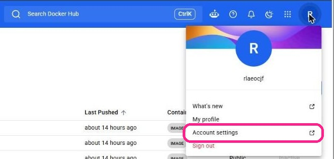
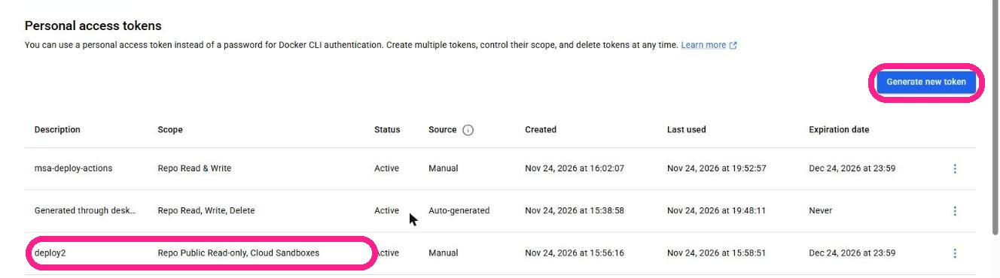
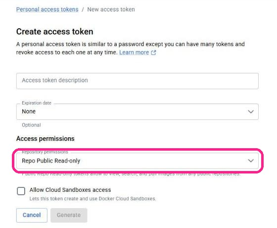
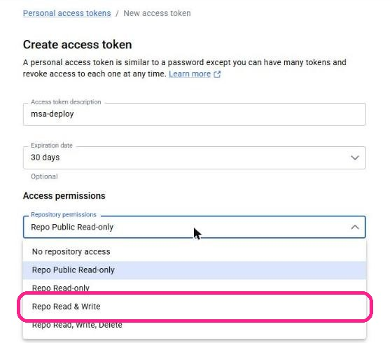
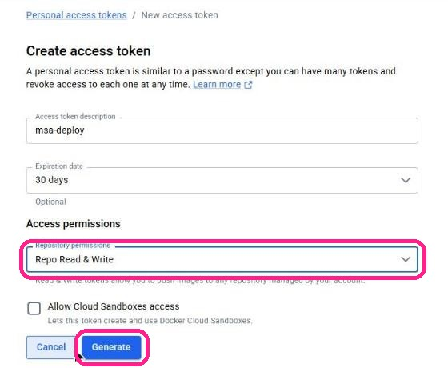
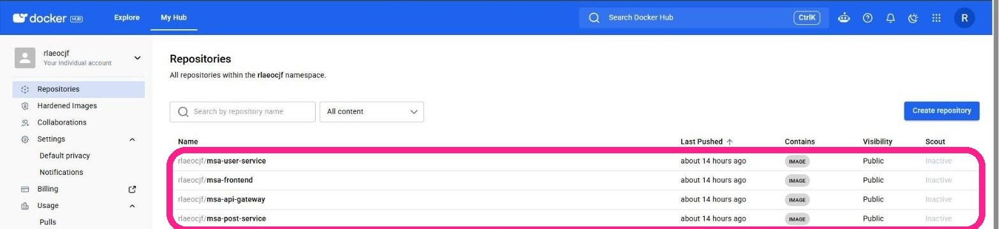

# 3장. Docker Hub 에 이미지 올리기

## 학습 목표

- 이미지 이름 `사용자이름/저장소:태그` 의 뜻을 안다.
- Docker Hub **Access Token** 을 만들고, 권한(Read & Write)을 바르게 고른다.
- 내 PC 에서 만든 이미지 4개를 Docker Hub 에 올린다(push).

## 3-1. 이미지 이름 읽기

```text
rlaeocjf / msa-user-service : latest
└─ 사용자 이름  └─ 저장소(이미지) 이름  └─ 태그(버전 이름)
```

- **사용자 이름**: Docker Hub 계정 이름. 다른 사람의 이름으로는 올릴 수 없다.
- **저장소 이름**: 이미지마다 하나. 처음 push 하면 Docker Hub 에 저절로 생긴다.
- **태그**: 같은 저장소 안의 버전 이름. `latest` 는 "가장 최근" 이라는 약속일 뿐 특별한 기능은 없다. 6장의 GitHub Actions 는 `latest` 와 함께 **커밋 번호** 태그도 붙여서 "어느 코드로 만든 이미지인지" 를 남긴다.

`postgres:18` 처럼 사용자 이름이 없는 이미지는 Docker 가 관리하는 **공식 이미지**다.

## 3-2. Access Token 만들기 (화면 따라 하기)

Docker Hub 에 로그인할 때 비밀번호 대신 **Access Token**(접근 토큰)을 쓴다. 토큰은 권한을 좁게 줄 수 있고, 잃어버리면 그 토큰만 지우면 된다. 이 장에서는 내 PC 의 `docker login` 에, 6장에서는 GitHub Actions 의 로그인에 이 토큰을 쓴다.

**① 계정 설정으로 가기** - https://hub.docker.com 에 로그인 → 오른쪽 위 동그란 프로필 → **Account settings**. 새 탭(app.docker.com)으로 열린다.



**② 토큰 목록** - 왼쪽 메뉴 **Personal access tokens** → 오른쪽 위 파란 **Generate new token**.



목록의 **Scope** 칸을 보자. 강사 화면의 `deploy2` 토큰은 `Repo Public Read-only` 다. 바로 이 토큰 때문에 push 가 실패했다(아래 주의 상자). `msa-deploy-actions` 는 `Repo Read & Write` 로 다시 만든 토큰이다.

**③ 새 토큰 입력 화면** - 처음 열면 권한이 **`Repo Public Read-only`** 로 골라져 있다. 그대로 Generate 를 누르면 push 할 수 없는 토큰이 만들어진다.



| 칸 | 넣을 값 |
|---|---|
| Access token description | `msa-deploy` (무엇에 쓰는 토큰인지 알아볼 이름) |
| Expiration date | `30 days` (실습 기간. None 은 만료되지 않아 잊어버리면 위험하다) |
| Repository permissions | **`Repo Read & Write`** ← 가장 중요 |
| Allow Cloud Sandboxes access | 체크하지 않는다 |

**④ 권한 고르기** - Repository permissions 칸을 눌러 **Repo Read & Write** 를 고른다.



| 권한 | 할 수 있는 일 | 이 교안에서 |
|---|---|---|
| Repo Public Read-only | 공개 이미지 받기(pull)만 | ✗ push 실패 |
| Repo Read-only | 내 비공개 이미지까지 받기만 | ✗ push 실패 |
| **Repo Read & Write** | 받기 + **올리기(push)** | ✔ 이것 |
| Repo Read, Write, Delete | 위 + 저장소 지우기 | 필요 이상으로 넓다 |



**⑤ Generate** 를 누르면 `dckr_pat_` 로 시작하는 긴 토큰이 **한 번만** 보인다. **Copy** 단추로 복사해서 메모장에 잠깐 붙여 둔다. 이 화면을 닫으면 다시 볼 수 없다. 잃어버렸으면 목록에서 그 토큰을 지우고(⋮ → Delete) 새로 만들면 된다.

> **권한을 Read-only 로 만들면 push 가 막힌다.** 교안을 만들 때 실제로 겪은 실수다. GitHub Actions 로그에 이런 줄이 나온다.
>
> `unexpected status from HEAD request to ...: 401 Unauthorized ... insufficient scopes`
>
> 로그인(login)은 성공하므로 헷갈리기 쉽다. "로그인은 되는데 push 만 안 된다" 면 토큰 권한부터 의심한다. Read & Write 토큰을 **새로 만들어** 바꾸는 것이 가장 확실하다. (잘못 만든 토큰은 목록의 ⋮ → Delete 로 지운다)

토큰은 비밀번호와 같다. 화면 캡처, 카톡, GitHub 코드 어디에도 남기지 않는다. 메모장의 토큰은 6장에서 GitHub Secrets 에 넣은 뒤 지운다.

## 3-3. 로그인하고 올리기

**[PS]** Docker Hub 로그인 - `Password:` 가 나오면 **비밀번호가 아니라 토큰**을 붙여 넣고 Enter

```powershell
# -u : 로그인할 사용자 이름. 비밀번호는 다음 줄에서 묻는다 (명령에 적지 않아야 기록에 남지 않는다)
# 한 번 로그인하면 Windows 자격 증명에 저장돼서, 다음부터 push 할 때 다시 묻지 않는다
docker login -u <내DockerHub아이디>    # 예: docker login -u rlaeocjf
```

```text
Password:                 ← 토큰을 붙여 넣는다 (Ctrl+V 또는 마우스 오른쪽 클릭). 글자가 보이지 않는 것이 정상
Login Succeeded
```

> PowerShell 에서는 **마우스 오른쪽 클릭**이 붙여넣기다. 붙여 넣었는데 아무것도 안 보여도 들어간 것이니 Enter 를 누른다. `unauthorized: incorrect username or password` 가 나오면 아이디 철자와 토큰을 다시 확인한다.

2장에서 만든 이미지 이름은 `local/msa-...` 였다. Docker Hub 에 올리려면 이름 앞부분이 **내 사용자 이름**이어야 한다. 저장소 폴더에 `.env` 파일을 만들면 compose 가 자동으로 읽어서 이름을 바꿔 준다.

**[PS]** `.env` 만들기 - `.env.example` 을 복사해서 사용자 이름만 바꾼다

```powershell
copy .env.example .env            # 본보기 파일을 .env 로 복사 (.env 는 .gitignore 에 있어 GitHub 에 올라가지 않는다)
notepad .env                      # 메모장이 열리면 DOCKERHUB_USERNAME=<내DockerHub아이디> 로 고치고 저장(Ctrl+S) 후 닫기
# config --images : 실제로 빌드하지 않고, compose 가 .env 까지 읽어서 "만들 이미지 이름" 만 미리 보여 준다
#                   앞부분이 local/ 이 아니라 내 아이디로 바뀌었는지 확인하는 용도
docker compose config --images
```

```text
rlaeocjf/msa-user-service:latest
rlaeocjf/msa-post-service:latest
rlaeocjf/msa-api-gateway:latest
rlaeocjf/msa-frontend:latest
postgres:18
```

줄의 순서는 위와 다를 수 있다. 앞부분이 `local/` 이 아니라 **내 아이디**로 바뀌었으면 성공이다. (`.env` 는 `.gitignore` 에 있어 GitHub 에 올라가지 않는다)

**[PS]** 새 이름으로 빌드하고 4개만 push - 2장에서 한 번 빌드했으므로 캐시 덕분에 빠르다

```powershell
# build : 이미지 이름이 내 아이디로 바뀌었으니 그 이름으로 다시 굽는다. 내용은 2장의 캐시를 다시 써서 1분 안쪽
docker compose build
# push 서비스이름... : 적은 서비스의 이미지만 Docker Hub 로 올린다
#   db(postgres:18)는 남의 공식 이미지라 올리지 않으려고 우리 것 4개만 적는다. 처음에는 몇 분 걸린다
docker compose push user-service post-service api-gateway frontend
```

```text
[+] Pushing 4/4
 ✔ Pushing rlaeocjf/msa-user-service:latest
 ✔ Pushing rlaeocjf/msa-post-service:latest
 ✔ Pushing rlaeocjf/msa-api-gateway:latest
 ✔ Pushing rlaeocjf/msa-frontend:latest
```

> 서비스 이름을 적어 **우리 것 4개만** 고른다. `db` 의 `postgres:18` 은 남의 이미지라 우리 계정으로 올릴 수 없고, 올릴 까닭도 없다. 서버도 Docker Hub 에서 공식 이미지를 바로 받는다.

> `denied: requested access to the resource is denied` 가 나오면 이미지 이름이 내 아이디가 아니거나(`.env` 를 저장하지 않았다), 로그인한 아이디와 `.env` 의 아이디가 다르다. `docker compose config --images` 로 이름부터 다시 본다.

https://hub.docker.com 의 **My Hub → Repositories** 에 저장소 4개가 생겼다. 처음 push 한 저장소는 **공개(Public)** 로 만들어진다. 공개 이미지는 누구나 받을(pull) 수 있지만, 올리기(push)는 나만 할 수 있다.



> **[배포 개념] 이미지 창고(레지스트리)가 있으면 빌드와 실행을 나눌 수 있다.** 빌드는 힘이 센 컴퓨터(내 PC, GitHub Actions)에서 하고, 메모리 1GB 짜리 서버는 **다 만든 이미지를 받아서 켜기만** 한다. 서버에 JDK, Gradle, Node.js, 소스 코드가 하나도 필요 없다.

> **이미지 안에 비밀 값이 있으면 안 된다.** 공개 이미지는 누구나 받아서 열어 볼 수 있다. 이 교안의 이미지에는 비밀번호·열쇠가 없고, 서버에서 켤 때 환경 변수로 넣는다(1장). Dockerfile 에 `ENV DB_PASSWORD=...` 같은 줄을 쓰지 않는 까닭이다.

## 확인 문제

1. `rlaeocjf/msa-frontend:latest` 에서 사용자 이름, 저장소 이름, 태그는 각각 무엇인가?
2. `docker login` 은 성공했는데 push 할 때 `insufficient scopes` 가 나왔다. 무엇을 고쳐야 하나?
3. 공개 저장소에 올린 이미지에 DB 비밀번호가 들어 있으면 왜 위험한가?
