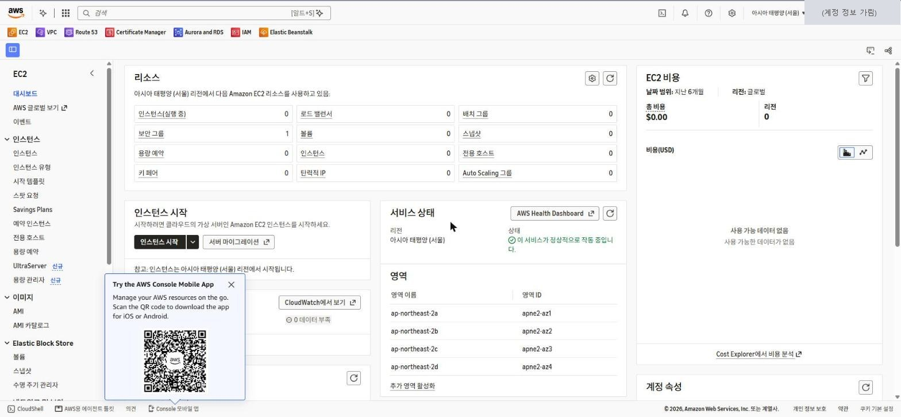
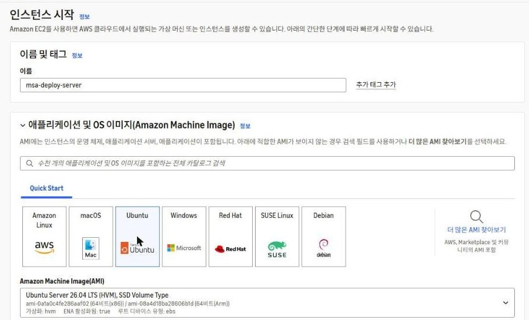
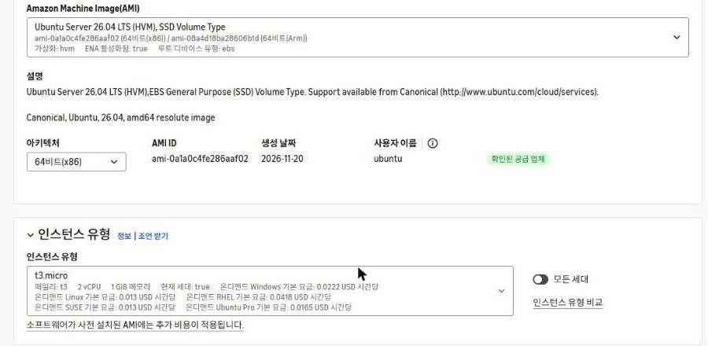
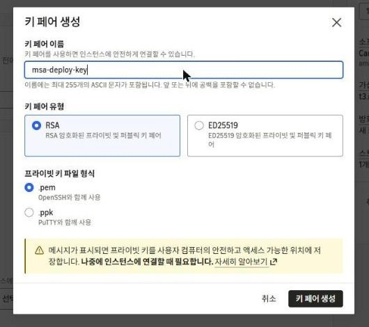
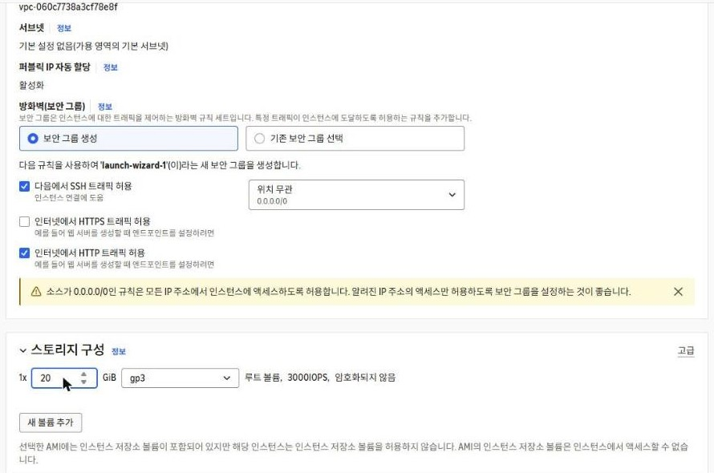
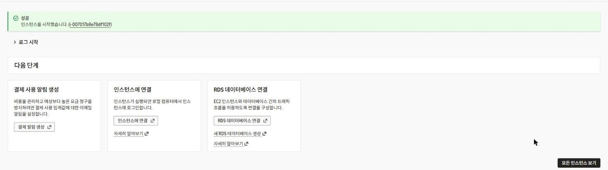
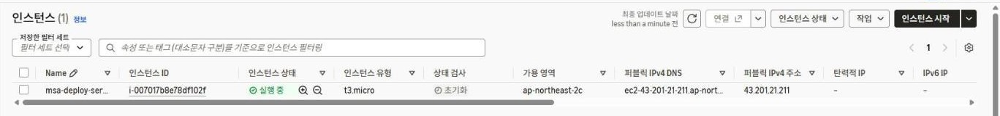

# 4장. AWS EC2 만들기

## 학습 목표

- EC2 인스턴스, AMI, 인스턴스 유형, 키 페어, 보안 그룹이 각각 무엇인지 안다.
- 서울 리전에 가장 싼 Ubuntu 서버(t3.micro)를 만든다.
- 보안 그룹으로 **22(SSH)와 80(HTTP)만** 연다.

## 4-1. 낱말 먼저

| 낱말 | 뜻 |
|---|---|
| EC2 | AWS 가 빌려주는 가상 컴퓨터 서비스. 빌린 컴퓨터 한 대를 **인스턴스**라고 부른다 |
| 리전(Region) | 컴퓨터가 있는 지역. 한국 사용자에게는 **아시아 태평양(서울) ap-northeast-2** 가 가깝다 |
| AMI | 인스턴스에 깔 운영체제 꾸러미. 이 교안은 **Ubuntu Server 26.04 LTS** |
| 인스턴스 유형 | 컴퓨터의 크기. **t3.micro** = CPU 2개, 메모리 1GB (가장 싼 축, 프리 티어 대상) |
| 키 페어 | SSH 로 접속할 때 쓰는 열쇠 한 쌍. 자물쇠(공개 키)는 서버에, 열쇠(`.pem`, 개인 키)는 내 PC 에 |
| 보안 그룹 | 인스턴스 앞의 방화벽. 어떤 포트를 누구에게 열지 정한다 |
| 퍼블릭 IP | 인터넷에서 이 인스턴스를 찾는 주소. 인스턴스를 **중지했다 켜면 바뀐다** (7장) |

## 4-2. 리전을 서울로

AWS 콘솔(https://console.aws.amazon.com)에 로그인하고, 위쪽 검색창에 `EC2` 를 쳐서 들어간다. **오른쪽 위 리전이 "아시아 태평양 (서울)"** 인지 꼭 확인한다. 다른 리전에 만들면 나중에 "인스턴스가 사라졌다" 고 착각하기 쉽다. (리전마다 화면이 따로다)

**인스턴스 시작** 을 누른다.

## 4-3. 이름과 운영체제

- **이름**: `msa-deploy-server`
- **애플리케이션 및 OS 이미지**: Quick Start 에서 **Ubuntu** → `Ubuntu Server 26.04 LTS` (64비트 x86)

> **LTS(Long Term Support)** 는 오랫동안 보안 업데이트를 해 주는 버전이다. 서버에는 LTS 를 쓴다. 교안을 만든 때보다 새 LTS 가 나왔다면 그것을 골라도 명령은 거의 같다.

## 4-4. 인스턴스 유형

**t3.micro** 를 고른다. 화면에 "온디맨드 Linux 기본 요금: 0.013 USD 시간당" 처럼 요금이 보인다. 켜 둔 시간만큼 붙는다.

> 메모리 1GB 에 서비스 3개 + DB + nginx 를 올리는 것은 빠듯하다. 그래서 2장에서 Java 메모리 한도를 정했고, 5장에서 **스왑(디스크를 메모리처럼 쓰기) 2GB** 를 더한다. 더 넉넉하게 하려면 t3.small(2GB)을 고르면 되지만 요금이 두 배다.

## 4-5. 키 페어 만들기

키 페어 칸 옆의 **새 키 페어 생성** 을 누른다.

- 이름: `msa-deploy-key`
- 유형: **RSA**, 파일 형식: **.pem** (Windows 의 `ssh` 명령도 .pem 을 쓴다)
- **키 페어 생성** 을 누르면 `msa-deploy-key.pem` 이 **한 번만** 내려받아진다.

내려받은 파일은 잃어버리지 않을 곳으로 옮긴다. 이 교안은 `바탕 화면\공부자료\msa-deploy-key.pem` 에 두었다.

> **[배포 개념] .pem 파일은 서버의 열쇠다.** 이 파일만 있으면 누구나 내 서버에 들어올 수 있다. GitHub 에 올리지 않는다(`.gitignore` 에 `*.pem` 이 있다). 잃어버리면 AWS 도 다시 만들어 주지 않는다. 그 서버에는 다시 접속할 수 없으니 새로 만들어야 한다.

## 4-6. 네트워크(보안 그룹)와 저장소

**네트워크 설정** 에서 "보안 그룹 생성" 을 그대로 두고 체크 칸을 이렇게 맞춘다.

| 규칙 | 체크 | 까닭 |
|---|---|---|
| 다음에서 SSH 트래픽 허용 (22) · 위치 무관 0.0.0.0/0 | ✔ | 내 PC 와 **GitHub Actions** 가 접속한다 |
| 인터넷에서 HTTPS 트래픽 허용 (443) | 끔 | 이 교안은 HTTPS 를 다루지 않는다 (8장 더 나아가기) |
| 인터넷에서 HTTP 트래픽 허용 (80) | ✔ | 사용자가 게시판에 들어오는 문 |

> **SSH 를 "위치 무관" 으로 여는 까닭** - 노란 경고처럼 "내 IP" 로만 여는 것이 더 안전하다. 그런데 GitHub Actions 는 실행할 때마다 **다른 IP 의 컴퓨터**에서 접속하므로 내 IP 로 막으면 자동 배포가 실패한다. 대신 비밀번호 로그인은 꺼져 있고 **.pem 열쇠로만** 들어올 수 있으니, 열쇠만 잘 지키면 된다.

**스토리지 구성** 은 기본 8GiB 를 **20GiB gp3** 로 늘린다. 이미지 4개(백엔드 하나에 약 590MB) + postgres + 새 버전을 받을 때 잠깐 겹치는 공간까지 생각하면 8GiB 는 금방 찬다. (프리 티어는 30GiB 까지)

오른쪽 **요약** 에서 Ubuntu 26.04, t3.micro, 새 보안 그룹, 20GiB 를 한 번 더 보고 **인스턴스 시작** 을 누른다.

## 4-7. 만들어졌는지 확인

**모든 인스턴스 보기** 를 누른다. 1~2분 지나면 인스턴스 상태가 **실행 중**, 상태 검사가 **3/3 검사 통과** 로 바뀐다.

**퍼블릭 IPv4 주소**(예: `43.201.21.211`)를 적어 둔다. 5장에서 이 주소로 접속하고, 6장에서 GitHub 에 `EC2_HOST` 로 넣는다.

> **보안 그룹 이름은 `launch-wizard-1`** 처럼 자동으로 붙는다. 8장에서 인스턴스를 지운 뒤 함께 지운다.

## 확인 문제

1. 인스턴스를 만들 때 리전을 확인해야 하는 까닭은?
2. `.pem` 파일을 잃어버리면 어떻게 되나?
3. 보안 그룹에서 8080(게이트웨이)이나 5432(DB)를 열지 않아도 게시판이 동작하는 까닭은?
