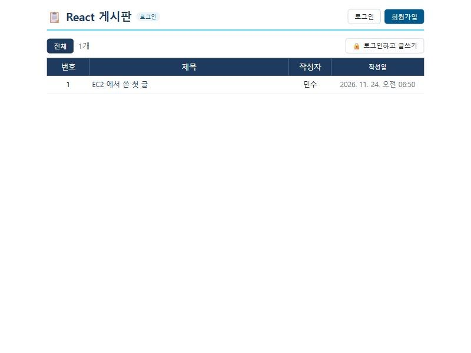
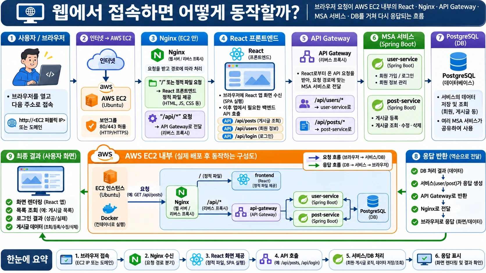

# 5장. 서버 준비와 첫 배포

## 학습 목표

- `.pem` 열쇠로 EC2 에 **SSH** 접속한다.
- 서버에 **스왑 메모리**와 **Docker** 를 설치한다.
- 자동 배포를 만들기 전에, **손으로 한 번** 배포해서 흐름을 익힌다.

> **[배포 개념] 자동화하기 전에 손으로 먼저.** 6장의 GitHub Actions 는 이 장에서 손으로 하는 일(파일 복사 → `docker compose pull` → `up -d`)을 그대로 대신 쳐 줄 뿐이다. 손으로 한 번 해 보면 자동 배포가 실패했을 때 어디서 막혔는지 금방 찾는다.

**이 장에서는 PowerShell 창을 두 개** 쓰면 편하다.

| 창 | 프롬프트 | 하는 일 |
|---|---|---|
| ① 내 PC 창 **[PS]** | `PS C:\study\react-spring-msa-deploy>` | 열쇠 권한, 파일 보내기(scp) |
| ② 서버 창 **[EC2]** | `ubuntu@ip-172-31-xx-xx:~$` | ssh 로 접속한 뒤 서버에서 치는 명령 |

②번 창도 처음에는 PowerShell 이다. `ssh` 로 접속하는 순간부터 그 창은 **서버의 터미널**이 된다.

> **VS Code 를 쓴다면** 터미널 오른쪽 위 **+ ∨ → PowerShell** 로 터미널을 하나 더 연다(0장 0-4). 오른쪽 목록에 `powershell` 이 두 개 생기고, 눌러서 오갈 수 있다. 하나는 ① 내 PC 용, 다른 하나는 ② ssh 용으로 쓴다. 프롬프트를 보고 지금 어느 컴퓨터에 명령을 치는지 늘 확인한다.

## 5-1. 열쇠 파일 권한 좁히기

4장에서 내려받은 `msa-deploy-key.pem` 은 보통 **다운로드** 폴더에 있다. 잃어버리지 않을 곳으로 옮겨 두자. 이 교안은 `바탕 화면\공부자료` 에 두었다. 다른 곳에 두었다면 아래 `$key = ...` 줄의 경로만 내 경로로 바꾼다.

`ssh` 는 열쇠 파일을 **나만 읽을 수 있어야** 쓴다. 다른 사용자도 읽을 수 있으면 "UNPROTECTED PRIVATE KEY FILE!" 이라며 접속을 거절한다. Windows 에서는 `icacls` 로 권한을 좁힌다.

**[PS]** ① 내 PC 창 - 열쇠 경로를 변수에 담고, 파일이 있는지 확인하고, 권한 정리 (한 번만)

```powershell
$key = "$env:USERPROFILE\Desktop\공부자료\msa-deploy-key.pem"   # 열쇠 파일 위치 (내가 둔 곳으로 바꾼다)
Test-Path $key                                    # True 가 나와야 한다. False 면 경로가 틀렸다
icacls $key /inheritance:r                        # 폴더에서 물려받은 권한(다른 사용자 포함)을 모두 지운다
icacls $key /grant:r "$($env:USERNAME):(R)"       # 나(지금 로그인한 Windows 사용자)에게만 읽기(R) 권한을 준다
```

```text
True
processed file: C:\Users\...\Desktop\공부자료\msa-deploy-key.pem
Successfully processed 1 files; Failed processing 0 files
processed file: C:\Users\...\Desktop\공부자료\msa-deploy-key.pem
Successfully processed 1 files; Failed processing 0 files
```

> **`$key` 는 이 PowerShell 창 안에서만 기억된다.** 창을 닫았다가 새로 열면 첫 줄(`$key = ...`)만 다시 친다. `icacls` 두 줄은 파일에 한 번 적용되면 남으니 다시 하지 않아도 된다.

## 5-2. SSH 로 접속하기

**[PS]** ② 서버 창으로 쓸 PowerShell 을 하나 더 열고 - `<EC2주소>` 는 4장에서 적어 둔 퍼블릭 IPv4 주소

```powershell
$key = "$env:USERPROFILE\Desktop\공부자료\msa-deploy-key.pem"   # 새 창이므로 변수를 다시 만든다
ssh -i $key ubuntu@<EC2주소>                       # -i 열쇠 파일, ubuntu 는 사용자 이름, @ 뒤는 서버 주소
```

처음 접속하면 "이 서버가 맞습니까?" 하고 묻는다. `yes` 를 **글자로** 치고 Enter. (y 만 치면 안 된다) 서버의 지문이 내 PC 의 `known_hosts` 파일에 저장되고, 다음부터는 묻지 않는다.

```text
The authenticity of host '43.201.21.211' can't be established.
ED25519 key fingerprint is SHA256:....
Are you sure you want to continue connecting (yes/no/[fingerprint])? yes
Warning: Permanently added '43.201.21.211' (ED25519) to the list of known hosts.
Welcome to Ubuntu 26.04.1 LTS (GNU/Linux ...)
ubuntu@ip-172-31-xx-xx:~$
```

프롬프트가 `ubuntu@ip-...:~$` 로 바뀌면 이제부터 이 창에 치는 명령은 **EC2 에서** 실행된다. 빠져나올 때는 `exit` 를 친다.

> `ubuntu` 는 Ubuntu AMI 의 기본 사용자 이름이다. (Amazon Linux 라면 `ec2-user`) 4장 d03 화면의 "사용자 이름" 칸에도 적혀 있다.

> **접속이 안 될 때** - `Connection timed out` 은 주소가 틀렸거나 보안 그룹에 22 번이 없을 때, `Permission denied (publickey)` 는 사용자 이름이나 열쇠 파일이 틀렸을 때다. 인스턴스를 막 만들었다면 1~2분 기다렸다가 다시 해 본다. (부록 A-3)

## 5-3. 스왑 2GB 와 Docker 설치

**[EC2]** ② 서버 창 - 스왑 만들기. 메모리가 모자라면 디스크 2GB 를 메모리처럼 빌려 쓴다

```bash
sudo fallocate -l 2G /swapfile       # 2GB 짜리 빈 파일 만들기 (sudo = 관리자 권한으로 실행)
sudo chmod 600 /swapfile             # 관리자(root)만 읽고 쓰게 (보안)
sudo mkswap /swapfile                # 이 파일을 스왑 공간으로 준비
sudo swapon /swapfile                # 지금 바로 스왑 켜기
echo '/swapfile none swap sw 0 0' | sudo tee -a /etc/fstab   # 재부팅해도 스왑이 저절로 켜지게 설정 파일에 한 줄 추가
free -m                              # 메모리와 스왑 크기 확인 (MB 단위)
```

```text
               total        used        free   ...
Mem:             908         ...
Swap:           2047           0        2047
```

`Swap: 2047` 이 보이면 성공이다. 스왑은 진짜 메모리보다 훨씬 느리지만, 서비스가 켜질 때 잠깐 메모리가 몰려도 **프로그램이 강제로 꺼지지(OOM) 않게** 지켜 준다.

> `echo ... | sudo tee -a /etc/fstab` 는 **한 번만** 친다. 두 번 치면 같은 줄이 두 번 들어간다. (해가 되지는 않지만 지저분하다)

**[EC2]** Docker 와 compose 설치 - Ubuntu 기본 저장소에서 (1~2분)

```bash
sudo apt-get update                                   # 설치할 수 있는 프로그램 목록 새로 받기
sudo apt-get install -y docker.io docker-compose-v2   # Docker 엔진과 compose 플러그인 설치 (-y = 묻지 말고 설치)
sudo usermod -aG docker ubuntu                        # ubuntu 사용자를 docker 그룹에 넣기 → sudo 없이 docker 명령 사용
exit                                                  # 그룹 변경을 적용하려고 한 번 나간다
```

`usermod` 로 바꾼 그룹은 **다시 접속해야** 적용된다. 그래서 `exit` 로 나왔다가 다시 들어간다. 프롬프트가 `PS ...>` 로 돌아오면 나온 것이다.

**[PS]** ② 서버 창 - 다시 접속 (위쪽 화살표 키로 이전 명령을 불러와도 된다)

```powershell
ssh -i $key ubuntu@<EC2주소>     # 같은 명령으로 다시 접속 (이번에는 yes 를 묻지 않는다)
```

**[EC2]** 설치 확인

```bash
docker --version          # Docker version 2x.x ...
docker compose version    # Docker Compose version 2.x ...
docker ps                 # 지금 도는 컨테이너 목록 (아직 없으니 머리글만 나온다)
```

```text
CONTAINER ID   IMAGE     COMMAND   CREATED   STATUS    PORTS     NAMES
```

`docker ps` 가 `permission denied` 없이 머리글만 보여 주면 준비 끝이다. `permission denied ... docker.sock` 이 나오면 `exit` 후 다시 접속하지 않은 것이다.

## 5-4. 서버용 compose 파일

서버에서는 2장의 `docker-compose.yml` 대신 `deploy/docker-compose.prod.yml` 을 쓴다. 다른 점은 두 가지다.

1. **`build:` 가 없다.** 서버에는 소스 코드가 없다. Docker Hub 의 이미지를 받아서 쓴다.
2. **비밀 값에 기본값이 없다.** `${DB_PASSWORD:?...}` 는 "값이 없으면 오류를 내고 멈춰라" 라는 뜻이다. 실수로 `.env` 를 빠뜨려 `postgres` 같은 약한 비밀번호로 켜지는 일을 막는다.

<!-- file: deploy/docker-compose.prod.yml -->

```yaml
# =====================================================================
# docker-compose.prod.yml - 서버(EC2)에서 실행하는 설정
#
# GitHub Actions 가 이 파일을 서버의 ~/app/docker-compose.yml 로 복사하고 아래를 실행한다.
#   docker compose pull      Docker Hub 에서 새 이미지 받기
#   docker compose up -d     바뀐 컨테이너만 새로 켜기
#
# 내 PC 용 docker-compose.yml 과 다른 점
#   - build: 가 없다. 서버에는 소스 코드가 없고, Docker Hub 의 이미지를 받아서 쓴다.
#   - 비밀 값(DB_PASSWORD, JWT_SECRET)은 같은 폴더의 .env 파일에서 읽는다.
#     .env 는 GitHub Actions 가 GitHub Secrets 로 만들어 준다 (GitHub 저장소에는 올라가지 않는다).
#   - 기본값(:-postgres 같은)을 두지 않는다. .env 가 없으면 바로 오류가 나서 실수를 알아챌 수 있다.
#
# 읽는 법
#   ${이름}          같은 폴더 .env 의 값으로 바뀐다
#   ${이름:?문장}    .env 에 값이 없으면 "문장" 을 오류로 보여 주고 멈춘다
# =====================================================================

name: msa-deploy                # 컨테이너 이름 앞에 붙는 프로젝트 이름 (msa-deploy-db-1 처럼)

services:
  # ---------- 데이터베이스: 컨테이너 1개, DB 2개 (userdb, postdb) ----------
  db:
    image: postgres:18           # Docker 공식 PostgreSQL 18 이미지 (Docker Hub 에서 받는다)
    restart: unless-stopped      # 죽거나 서버가 재부팅되면 다시 켠다 (사람이 docker stop 한 경우만 빼고)
    environment:
      POSTGRES_USER: postgres
      POSTGRES_PASSWORD: ${DB_PASSWORD:?DB_PASSWORD 가 .env 에 없습니다}   # DB 를 "처음" 만들 때만 쓰이는 비밀번호
      TZ: Asia/Seoul              # 컨테이너 시간대를 한국으로
    command: ["postgres", "-c", "timezone=Asia/Seoul"]   # DB 의 기본 시간대도 한국으로
    volumes:
      - db_data:/var/lib/postgresql               # 글·회원 데이터 (컨테이너를 새로 만들어도 남는다)
      - ./db:/docker-entrypoint-initdb.d           # 처음 켤 때 userdb, postdb 생성
    healthcheck:                  # "DB 가 요청을 받을 준비가 됐나" 를 5초마다 검사한다
      test: ["CMD-SHELL", "pg_isready -U postgres -d postdb"]
      interval: 5s
      timeout: 3s
      retries: 20                 # 20번(약 100초)까지 기다린다. 통과하면 상태가 healthy 가 된다

  # ---------- 회원 서비스 ----------
  user-service:
    image: ${DOCKERHUB_USERNAME:?}/msa-user-service:latest   # GitHub Actions 가 올린 내 이미지
    restart: unless-stopped
    environment:                  # application.yml 의 ${DB_URL} 같은 자리에 들어갈 값
      TZ: Asia/Seoul                              # 시간대를 한국으로 (없으면 UTC 라 글 작성 시각이 9시간 늦게 보인다)
      DB_URL: jdbc:postgresql://db:5432/userdb     # localhost 가 아니라 서비스 이름 db (같은 도커 네트워크)
      DB_PASSWORD: ${DB_PASSWORD:?}
      JWT_SECRET: ${JWT_SECRET:?JWT_SECRET 이 .env 에 없습니다}   # 토큰을 서명하는 열쇠 (게이트웨이와 같은 값)
    depends_on:
      db:
        condition: service_healthy                 # DB 의 healthcheck 가 통과한 뒤에 켠다

  # ---------- 게시글 서비스 ----------
  post-service:
    image: ${DOCKERHUB_USERNAME:?}/msa-post-service:latest
    restart: unless-stopped
    environment:
      TZ: Asia/Seoul                              # 시간대를 한국으로 (없으면 UTC 라 글 작성 시각이 9시간 늦게 보인다)
      DB_URL: jdbc:postgresql://db:5432/postdb     # 게시글 서비스는 postdb 만 쓴다 (Database per Service)
      DB_PASSWORD: ${DB_PASSWORD:?}
    depends_on:
      db:
        condition: service_healthy

  # ---------- 게이트웨이 (정문) ----------
  api-gateway:
    image: ${DOCKERHUB_USERNAME:?}/msa-api-gateway:latest
    restart: unless-stopped
    environment:
      TZ: Asia/Seoul                              # 시간대를 한국으로 (없으면 UTC 라 글 작성 시각이 9시간 늦게 보인다)
      USER_SERVICE_URL: http://user-service:8081   # 길 안내할 서비스 주소도 서비스 이름으로
      POST_SERVICE_URL: http://post-service:8082
      JWT_SECRET: ${JWT_SECRET:?}                  # user-service 가 서명한 토큰을 같은 열쇠로 검사한다
    depends_on:                   # 두 서비스가 "켜지기 시작한" 뒤에 켠다 (다 켜질 때까지 기다리지는 않는다)
      - user-service
      - post-service

  # ---------- 화면 (React + nginx) - 바깥에 열린 유일한 문 ----------
  frontend:
    image: ${DOCKERHUB_USERNAME:?}/msa-frontend:latest
    restart: unless-stopped
    ports:
      - "80:80"                                    # 서버의 80 번 → nginx 80 번. 바깥(인터넷)에 열린 유일한 문
    depends_on:
      - api-gateway

volumes:
  db_data:                        # Docker 가 관리하는 저장 공간. docker compose down -v 를 해야만 지워진다
```

| 표현 | 뜻 |
|---|---|
| `${DOCKERHUB_USERNAME:?}` | `.env` 의 값으로 바꾼다. 없으면 오류 |
| `${DB_PASSWORD:?DB_PASSWORD 가 .env 에 없습니다}` | 없으면 뒤의 문장을 오류 메시지로 보여 주고 멈춘다 |
| `db_data:/var/lib/postgresql` | DB 파일을 **볼륨**(Docker 가 관리하는 저장 공간)에 둔다. 컨테이너를 지우고 새로 만들어도 데이터가 남는다 |
| `./db:/docker-entrypoint-initdb.d` | DB 를 **처음** 만들 때 `init.sql` 을 실행해 `userdb`, `postdb` 를 만든다 |

## 5-5. 손으로 첫 배포

서버의 `~/app` 폴더(`/home/ubuntu/app`)에 파일 3개를 둔다.

```text
~/app/
├─ docker-compose.yml     ← deploy/docker-compose.prod.yml 을 이 이름으로
├─ .env                   ← 비밀 값 (내 PC 에서 만들어 보낸다)
└─ db/init.sql            ← userdb, postdb 만들기
```

**[PS]** ① 내 PC 창 - 서버용 `.env` 만들기. 비밀 값은 길고 아무렇게나 (아래 명령이 40글자를 만들어 준다)

```powershell
cd C:\study\react-spring-msa-deploy       # 저장소 폴더에서 해야 한다
# 영어 대·소문자와 숫자 62글자 중 40글자를 무작위로 뽑아 이어 붙이는 함수
function New-Secret { -join ((48..57) + (65..90) + (97..122) | Get-Random -Count 40 | ForEach-Object { [char]$_ }) }
$hubId = "<내DockerHub아이디>"            # 예: $hubId = "rlaeocjf"  (< > 는 지운다)
# 세 줄짜리 글 만들기. `n 은 줄바꿈, $(New-Secret) 자리에 무작위 40글자가 들어간다
$text = "DOCKERHUB_USERNAME=$hubId`nDB_PASSWORD=$(New-Secret)`nJWT_SECRET=$(New-Secret)`n"
[IO.File]::WriteAllText("$PWD\server.env", $text)   # server.env 파일로 저장 (리눅스 방식 줄바꿈, BOM 없는 UTF-8)
Get-Content server.env                    # 세 줄이 잘 들어갔는지 확인
```

```text
DOCKERHUB_USERNAME=rlaeocjf
DB_PASSWORD=Xk3...(무작위 40글자)
JWT_SECRET=p9Q...(무작위 40글자)
```

두 비밀 값은 6장에서 GitHub Secrets 에 **똑같이** 넣는다. 이 파일을 지우지 말고 둔다.

> **왜 `Set-Content` 나 메모장이 아니라 `WriteAllText` 일까?** Windows 는 줄 끝에 눈에 안 보이는 글자(`\r`)를 하나 더 붙인다. 서버(리눅스)에서 이 글자가 비밀번호 끝에 붙어 들어가면, 6장에서 GitHub Actions 가 만든 `.env`(이 글자 없음)와 비밀번호가 달라져 DB 접속이 실패할 수 있다. `WriteAllText` 와 `` `n `` 으로 리눅스 방식 줄바꿈만 쓰면 이 문제가 없다.

> `server.env` 는 저장소 폴더에 만들지만 `.gitignore` 에 넣어 두어서 GitHub 에 올라가지 않는다. 6장에서 GitHub Secrets 에 값을 옮긴 뒤 지운다. 혹시 `git status` 에 보이면 절대 커밋하지 않는다.

**[PS]** ① 내 PC 창 - 파일 3개 보내기. `scp` 는 SSH 로 파일을 복사하는 명령이다 (`scp 보낼파일 사용자@주소:받을곳`)

```powershell
ssh -i $key ubuntu@<EC2주소> "mkdir -p ~/app/db"                                     # 서버에 ~/app/db 폴더 만들기 (명령 하나만 실행하고 바로 돌아온다)
scp -i $key deploy/docker-compose.prod.yml ubuntu@<EC2주소>:~/app/docker-compose.yml   # 서버에서는 docker-compose.yml 이라는 이름으로
scp -i $key server.env ubuntu@<EC2주소>:~/app/.env                                    # 서버에서는 .env 라는 이름으로
scp -i $key db/init.sql ubuntu@<EC2주소>:~/app/db/init.sql                            # DB 2개를 만드는 SQL
```

```text
docker-compose.prod.yml          100% 3203   ...
server.env                       100%  133   ...
init.sql                         100%  521   ...
```

> `No such file or directory` 가 나오면 저장소 폴더가 아닌 곳에서 친 것이다. `cd C:\study\react-spring-msa-deploy` 후 다시 한다. 앞의 상대 경로(`deploy/...`, `db/...`)는 지금 폴더를 기준으로 찾는다.

**[EC2]** ② 서버 창 - 파일이 왔는지 보고, 이미지 받기와 켜기

```bash
cd ~/app                   # 파일을 보낸 폴더로 이동
ls -a                      # .env  db  docker-compose.yml 이 보여야 한다 (-a: 점으로 시작하는 숨은 파일까지)
docker compose pull        # Docker Hub 에서 이미지 5개 받기 (처음 1~2분)
docker compose up -d       # 5개 켜기 (-d: 뒤에서 돌게 하고 프롬프트를 바로 돌려준다)
docker compose ps          # 상태 확인
```

```text
SERVICE        STATUS                   PORTS
api-gateway    Up 40 seconds
db             Up 46 seconds (healthy)  5432/tcp
frontend       Up 40 seconds            0.0.0.0:80->80/tcp, [::]:80->80/tcp
post-service   Up 41 seconds
user-service   Up 41 seconds
```

> `docker compose pull` 이 `pull access denied` 나 `not found` 로 실패하면 `.env` 의 `DOCKERHUB_USERNAME` 이 틀렸거나, 3장에서 이미지를 아직 push 하지 않은 것이다. Docker Hub 의 내 저장소 목록에 `msa-...` 4개가 있는지 본다.

Spring 서비스는 1GB 서버에서 켜지는 데 **30초~1분** 쯤 걸린다. 그 사이에 접속하면 nginx 가 `502 Bad Gateway` 를 보여 준다. 잠시 기다렸다가 새로 고침하면 된다.

**[EC2]** 서비스가 다 켜졌는지 로그로 확인 (Ctrl+C 로 빠져나온다. 빠져나와도 서비스는 계속 돈다)

```bash
docker compose logs -f post-service     # -f: 새로 생기는 로그를 계속 따라가며 보여 준다
```

```text
post-service-1  | ... Started PostServiceApplication in 38.5 seconds ...
```

`Started PostServiceApplication in ... seconds` 가 보이면 켜진 것이다. user-service, api-gateway 도 같은 방법으로 볼 수 있다.

## 5-6. 인터넷에서 접속하기

내 PC 의 브라우저로 `http://<EC2주소>` 를 연다. (`https` 가 아니라 `http`. 브라우저가 https 로 바꾸려 하면 주소창에 `http://` 를 직접 쓴다)



회원가입 → 로그인 → 글쓰기를 해 본다. 휴대폰(와이파이를 끄고 LTE)으로 열어 봐도 된다. **인터넷 어디서나** 열리는 진짜 서버다.

방금 브라우저에서 한 일 하나하나가 EC2 안에서 어떻게 처리되는지 그림으로 정리해 보자. (Nginx 의 역할은 1장 1-3)



그림은 일반적인 구성을 그린 것이라 이 교안의 실제 설정과 다른 곳이 세 군데 있다.

| 그림 | 이 교안의 실제 |
|---|---|
| ② 보안 그룹 80/443 허용 | **22(SSH)와 80(HTTP)** 만 연다. 443(HTTPS)은 쓰지 않는다 (4장) |
| ⑤ `/api/users/*`, `/api/login` | 회원 API 는 **`/api/auth/*`** 다 (`/api/auth/signup`, `/api/auth/login`, `/api/auth/me`) → user-service |
| ⑦ 여러 서비스가 DB 를 공유 | 컨테이너는 하나지만 DB 는 **`userdb`, `postdb` 로 나뉘고**, 서비스마다 자기 DB 만 쓴다 (Database per Service) |

**[EC2]** 메모리는 괜찮을까?

```bash
free -m                                                              # 전체 메모리·스왑 사용량
docker stats --no-stream --format "table {{.Name}}\t{{.MemUsage}}"   # 컨테이너별 메모리 (--no-stream: 한 번만 찍고 끝)
```

```text
               total        used        free      shared  buff/cache   available
Mem:             908         704          94          10         232         203
Swap:           2047         383        1664
NAME                        MEM USAGE / LIMIT
msa-deploy-frontend-1       1.281MiB / 908.6MiB
msa-deploy-api-gateway-1    66.32MiB / 908.6MiB
msa-deploy-user-service-1   94.53MiB / 908.6MiB
msa-deploy-post-service-1   131MiB / 908.6MiB
msa-deploy-db-1             46.99MiB / 908.6MiB
```

교안을 만들 때 EC2 에서 잰 값이다. 메모리 908MB 중 700MB 쯤 쓰고, 모자란 만큼은 스왑(383MB)이 받쳐 준다. 오래 쓰지 않는 부분이 스왑으로 밀려나서 `docker stats` 의 숫자가 2장(내 PC)보다 작게 보인다.

> **[배포 개념] 지금까지 한 일을 정리하면** ① 이미지는 Docker Hub 에서 받았고(소스 없음) ② 비밀 값은 서버의 `.env` 에만 있고 ③ 바깥에는 80 만 열려 있다. 6장에서는 이 과정을 GitHub Actions 에 맡긴다. 그러면 `scp` 와 `docker compose pull` 을 사람이 칠 일이 없어진다.

## 확인 문제

1. `ssh` 가 "UNPROTECTED PRIVATE KEY FILE" 이라며 거절했다. 무엇을 해야 하나?
2. `sudo usermod -aG docker ubuntu` 를 한 뒤 다시 접속해야 하는 까닭은?
3. 배포 직후 브라우저에 `502 Bad Gateway` 가 보였다. 고장인가?
4. 서버용 compose 에서 `${DB_PASSWORD:?...}` 처럼 기본값 없이 쓰는 까닭은?
