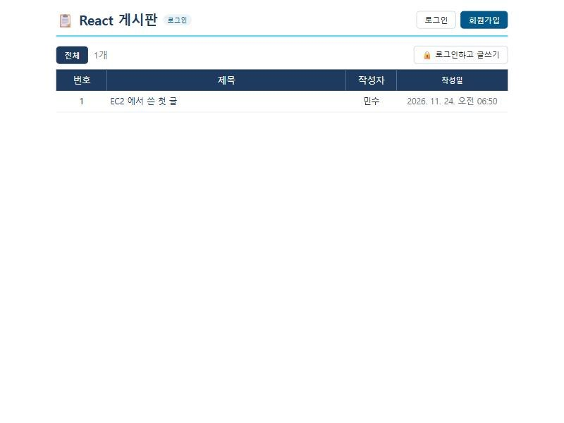
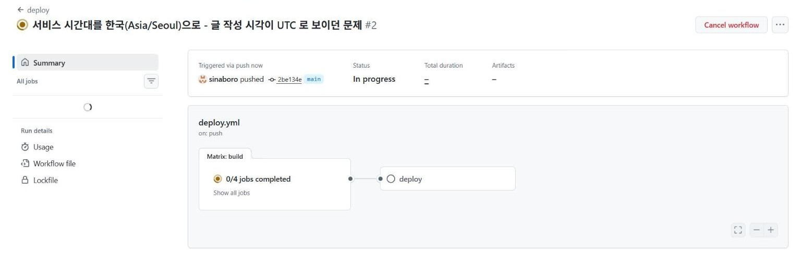
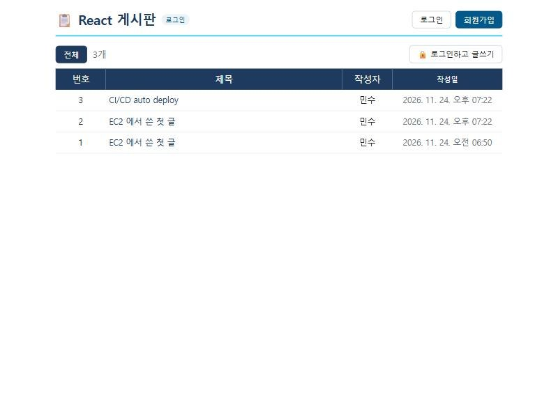
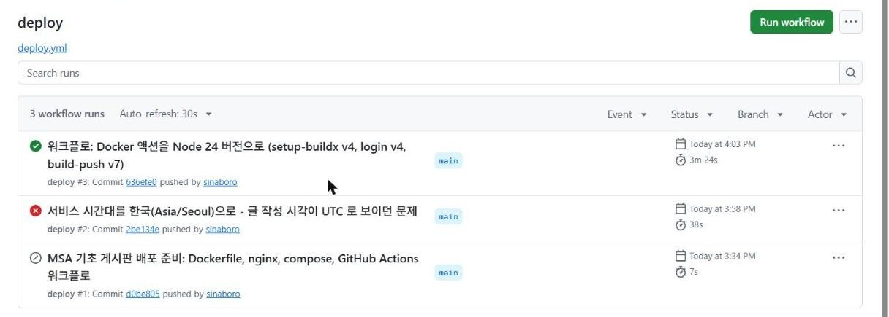
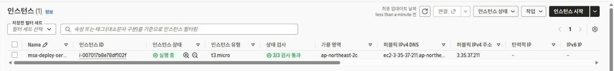

# 7장. 자동 배포 확인 - push 하면 서버가 바뀐다

## 학습 목표

- 코드를 고쳐 `git push` 하고, 몇 분 뒤 서버가 저절로 바뀌는 것을 확인한다.
- 실패한 워크플로의 로그를 읽고 원인을 찾는다.
- EC2 를 **중지했다 켜면 IP 가 바뀌는** 문제와 고치는 방법을 안다.

## 7-1. 교안을 만들 때 실제로 고친 버그 - 9시간 늦은 글

5장에서 처음 배포하고 글을 썼더니 작성일이 이상했다. 오후 3시 50분에 쓴 글이 **오전 06:50** 으로 보였다.



까닭은 **컨테이너의 시간대**다. Docker 이미지(eclipse-temurin, Ubuntu 기반)는 기본 시간대가 **UTC**(세계 표준시)이고, 한국(KST)은 UTC 보다 9시간 빠르다. post-service 는 `LocalDateTime.now()` 로 "지금 시각" 을 저장하는데, 컨테이너 안의 "지금" 이 UTC 였던 것이다. 내 PC 의 IntelliJ 에서 돌릴 때는 Windows 의 시간대(KST)를 따랐기 때문에 몰랐다.

> **[배포 개념] 내 PC 와 서버는 환경이 다르다.** 시간대, 글자 인코딩, 메모리, 파일 경로처럼 내 PC 에서는 저절로 맞던 것이 서버에서 어긋난다. 그래서 2장에서 **내 PC 에서도 컨테이너로** 돌려 보는 것이다. 이 버그도 컨테이너로 돌린 내 PC 에서 이미 재현됐다.

고친 방법은 compose 파일의 서비스 3개에 환경 변수 한 줄을 더한 것이다. (`deploy/docker-compose.prod.yml` 과 `docker-compose.yml` 둘 다)

```yaml
  post-service:
    environment:
      TZ: Asia/Seoul        # 시간대를 한국으로 (없으면 UTC 라 글 작성 시각이 9시간 늦게 보인다)
```

그리고 push 했다.

**[PS]** 커밋하고 push

```powershell
git add .
git commit -m "서비스 시간대를 한국(Asia/Seoul)으로 - 글 작성 시각이 UTC 로 보이던 문제"
git push
```

push 하자마자 Actions 탭에 새 실행이 생겼다. 제목은 커밋 메시지다.



2~3분 뒤 초록색으로 끝났고, 새 글을 써 보니 시각이 맞았다.



1번 글은 여전히 오전 06:50 이다. 시간대를 고친 것은 "앞으로 저장할 시각" 이고, 이미 DB 에 저장된 값은 바꾸지 않기 때문이다. (실제 서비스라면 데이터를 고치는 SQL 을 따로 돌린다)

`docker compose up -d` 는 설정(environment)이 바뀐 서비스 3개만 새로 만들고 **db 는 그대로** 두었다. 그래서 회원과 글이 모두 남아 있다.

## 7-2. 직접 해 보기 - 제목 바꾸기

이제 내 손으로 해 보자. 화면 맨 위 제목을 바꾼다.

**`frontend/src/components/Layout.jsx`** 에서 한 줄을 고친다.

```jsx
        <Link to="/" className="logo">
          📋 React 게시판 - 자동 배포 성공!
        </Link>
```

**[PS]** push

```powershell
git add frontend/src/components/Layout.jsx
git commit -m "제목 바꾸기 - 자동 배포 확인"
git push
```

1. GitHub 저장소의 **Actions** 탭에서 실행을 지켜본다. build 4개 → deploy 순서로 초록색이 켜진다.
2. 초록색으로 끝나면 `http://<EC2주소>` 를 **새로 고침** 한다. 제목이 바뀌어 있다.
3. 로그인 상태, 글 목록은 그대로다.

이번에는 React 만 고쳤지만 워크플로는 이미지 4개를 모두 다시 굽는다. 백엔드 3개는 소스가 그대로라 캐시 덕분에 몇십 초 만에 끝나고, Docker Hub 에 올릴 때도 바뀐 층(layer)이 없어 금방 끝난다. 서버의 `docker compose pull` 도 바뀐 frontend 만 새로 받는다.

> 브라우저가 옛 화면을 기억(캐시)하고 있으면 바로 안 바뀔 수 있다. **Ctrl+Shift+R** 로 강력 새로 고침 한다.

## 7-3. 실행 기록 읽기

**Actions** 탭 → 왼쪽 **deploy** 를 누르면 지금까지의 실행이 모두 보인다.



교안을 만들 때 남은 기록을 아래에서 위로 읽어 보자.

| 실행 | 결과 | 까닭 |
|---|---|---|
| #1 | 회색 (7초) | 처음 push 할 때는 Variables 가 없어서 `if:` 조건으로 **건너뜀**. 실패가 아니다 |
| #2 | 빨강 (38초) | Docker Hub 토큰이 Read-only → push 단계에서 `insufficient scopes` (3장) |
| #3 | 초록 (3분 24초) | 토큰을 Read & Write 로 바꾸고 다시 push. 첫 빌드라 캐시가 없어 오래 걸림 |

실패한 실행을 누르면 어느 잡의 어느 스텝에서 멈췄는지 빨간 ✕ 로 보인다. 그 스텝을 펼치면 로그 끝부분에 오류 메시지가 있다. **맨 아래 몇 줄**부터 읽는 것이 요령이다.

## 7-4. EC2 를 껐다 켰더니 배포가 실패한다 - IP 가 바뀐다

요금을 아끼려고 EC2 를 **중지**(Stop)했다가 다시 **시작**(Start)하면 **퍼블릭 IP 가 바뀐다.** 교안을 만들 때도 실제로 겪었다.



이때 생기는 일은 셋이다.

1. 예전 주소(`http://43.201.21.211`)로는 게시판이 열리지 않는다.
2. 워크플로의 deploy 잡이 **SSH 키 준비** 나 **파일 복사** 스텝에서 실패한다. (`Process completed with exit code 255` - ssh 가 접속하지 못했다는 뜻) GitHub 의 `EC2_HOST` 가 아직 예전 주소이기 때문이다.
3. 내 PC 에서 새 주소로 `ssh` 하면 처음 접속처럼 `yes/no` 를 묻는다. 반대로 AWS 가 예전 주소를 다른 사람의 서버에 주었다면, 예전 주소로 접속할 때 `REMOTE HOST IDENTIFICATION HAS CHANGED!` 경고가 나온다.

**고치는 방법**

1. EC2 콘솔에서 새 퍼블릭 IP 를 확인한다.
2. GitHub 저장소 → Settings → Secrets and variables → Actions → **Variables** → `EC2_HOST` 의 연필(편집) → 새 IP → **Update variable**.
3. Actions → deploy → **Run workflow** 로 다시 배포한다. 코드는 그대로이니 push 대신 손으로 돌린다.

**[PS]** 내 PC 에 남은 예전 서버 지문 지우기 (경고가 나올 때)

```powershell
ssh-keygen -R 43.201.21.211
```

> **데이터는 남는다.** 중지·시작은 컴퓨터를 껐다 켠 것과 같다. 디스크(EBS)와 Docker 볼륨은 그대로이고, 컨테이너는 `restart: unless-stopped` 덕분에 Docker 가 켜지면서 저절로 다시 켜진다. 사라지는 것은 IP 뿐이다. 반대로 **종료(Terminate)** 는 컴퓨터를 버리는 것이라 디스크까지 지워진다(8장).

> **[배포 개념] 바뀌지 않는 주소가 필요하면** - AWS 의 **탄력적 IP(Elastic IP)** 를 인스턴스에 붙이면 중지·시작해도 IP 가 그대로다. 실제 서비스는 여기에 **도메인**(예: `board.example.com`)을 연결해서 사람은 도메인만 기억하게 한다. 탄력적 IP 도 공인 IP 요금이 붙고, 인스턴스에서 떼어 둔 채 남겨도 요금이 나가니 실습 뒤에는 꼭 **릴리스**한다.

## 7-5. 손으로 다시 배포하기

다음 같은 때는 코드를 고치지 않고 **Run workflow** 로 다시 돌린다.

- 7-4 처럼 `EC2_HOST` 만 바꿨을 때
- Secrets 값(토큰 등)을 고쳤을 때
- 서버를 새로 만들었을 때 (스왑·Docker 설치까지 한 뒤)

GitHub Actions 가 `.env` 를 매번 새로 만들어 보내므로, 서버를 새로 만들어도 5장의 `scp` 를 다시 할 필요가 없다. **5-1 ~ 5-3(접속, 스왑, Docker 설치)만** 하고 Run workflow 를 누르면 된다.

## 확인 문제

1. 서비스 컨테이너의 시간대가 UTC 일 때 한국에서 오후 3시에 쓴 글은 몇 시로 저장되나?
2. 시간대를 고친 뒤에도 1번 글의 시각이 그대로인 까닭은?
3. EC2 를 중지했다 시작한 뒤 deploy 잡이 `exit code 255` 로 실패했다. 무엇을 고쳐야 하나?
4. EC2 를 "중지" 하는 것과 "종료" 하는 것의 차이는?
