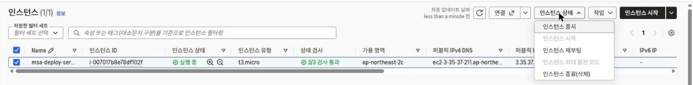
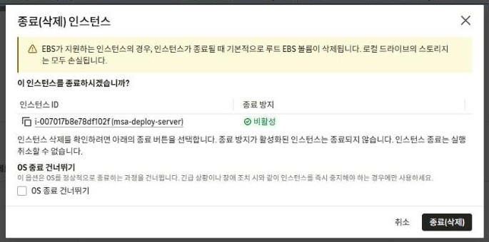
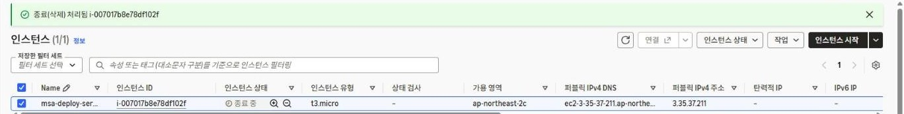
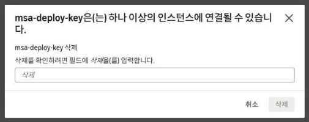

# 8장. 정리와 삭제 - 요금이 나가지 않게

## 학습 목표

- 지금까지 만든 배포 흐름을 한 장으로 정리한다.
- 실습이 끝나면 **EC2, 키 페어, 보안 그룹, 토큰, 열쇠 파일**을 빠짐없이 지운다.
- 실제 서비스로 가려면 무엇을 더해야 하는지 안다.

## 8-1. 한눈에 정리

| 단계 | 한 일 | 핵심 파일·설정 |
|---|---|---|
| 1장 | 주소를 `/api` 로, 비밀 값은 환경 변수로 | `api.js`, `nginx.conf`, `vite.config.js`, `application.yml` |
| 2장 | 서비스 4개를 이미지로, 내 PC 에서 운영처럼 실행 | `backend/Dockerfile`, `frontend/Dockerfile`, `docker-compose.yml` |
| 3장 | 이미지를 Docker Hub 에 (토큰은 Read & Write) | `docker login`, `docker compose push` |
| 4장 | 서울 리전 t3.micro Ubuntu, 22·80 만 열기 | 키 페어 `.pem`, 보안 그룹 |
| 5장 | 스왑·Docker 설치, 손으로 첫 배포 | `deploy/docker-compose.prod.yml`, `.env` |
| 6장 | Variables 3개, Secrets 4개, 워크플로 읽기 | `.github/workflows/deploy.yml` |
| 7장 | push → 자동 배포, IP 가 바뀌면 `EC2_HOST` 고치기 | Actions 탭, Run workflow |

> **[배포 개념] 이 교안의 배포를 한 문장으로** - "코드는 GitHub 에, 이미지는 Docker Hub 에, 비밀 값은 Secrets 와 서버 `.env` 에, 실행은 EC2 의 docker compose 가" 맡고, 그 사이를 GitHub Actions 가 잇는다.

## 8-2. 지우기 - 이 순서대로

EC2 는 **켜 둔 시간만큼** 요금이 붙는다. 실습이 끝나면 아래 순서대로 지운다. 앞의 것을 지워야 뒤의 것이 지워지는 경우가 있으니 순서를 지킨다.

**① EC2 인스턴스 종료(삭제)**

EC2 → **인스턴스** → `msa-deploy-server` 체크 → 위쪽 **인스턴스 상태** → **인스턴스 종료(삭제)**.







- 상태가 "종료 중" → "종료됨" 으로 바뀐다. 종료됨 인스턴스는 한 시간쯤 목록에 남았다가 사라진다.
- 디스크(EBS 20GiB)는 "종료 시 삭제" 가 기본값이라 함께 지워진다. **글·회원 데이터도 모두 사라진다.** 되돌릴 수 없다.
- "중지" 와 헷갈리지 않는다. 중지는 디스크 요금이 계속 나간다.

**② 키 페어 삭제**

EC2 → 왼쪽 **네트워크 및 보안** → **키 페어** → `msa-deploy-key` 체크 → **작업** → **삭제**. 확인 칸에 `삭제` 라고 직접 써야 삭제 단추가 눌린다. AWS 에 있는 자물쇠(공개 키)가 지워진다.



**③ 보안 그룹 삭제**

EC2 → **보안 그룹** → `launch-wizard-1` 체크 → **작업** → **보안 그룹 삭제**. 인스턴스가 보안 그룹을 놓아줘야 지워진다. "연결된 인스턴스가 있다" 고 나오면 몇 분 뒤에 다시 한다. (교안을 만들 때는 종료를 누르고 1분쯤 뒤에 바로 지워졌다) (`default` 보안 그룹은 지우지 않는다. 지울 수도 없다)

**④ 탄력적 IP (만들었다면)**

EC2 → **탄력적 IP** → 체크 → **작업** → **탄력적 IP 주소 릴리스**. 이 교안대로 했다면 만들지 않았으니 목록이 비어 있다.

**⑤ GitHub 저장소 정리**

- Settings → Secrets and variables → Actions → **Variables** 의 `EC2_HOST` 삭제. 이제 push 해도 deploy 잡은 건너뛴다(이미지 빌드만 한다).
- **Secrets** 의 `EC2_SSH_KEY` 삭제. 없어진 서버의 열쇠라 쓸모가 없다.
- 이미지 빌드도 멈추려면 `DOCKERHUB_USERNAME` 도 지운다(build 잡도 건너뜀).

**⑥ Docker Hub 정리**

- Account settings → **Personal access tokens** → `msa-deploy` 토큰 **Delete**. GitHub Secrets 의 `DOCKERHUB_TOKEN` 도 지운다.
- 공개 저장소(이미지)는 남겨 두어도 요금이 없다. 지우려면 저장소 → **Settings** → **Delete repository**.

**⑦ 내 PC 정리**

**[PS]** 열쇠 파일과 서버용 .env 지우기

```powershell
Remove-Item "$env:USERPROFILE\Desktop\공부자료\msa-deploy-key.pem"
Remove-Item server.env -ErrorAction SilentlyContinue
docker compose down -v          # 2장에서 켠 내 PC 의 컨테이너와 데이터
```

**⑧ 요금 확인**

AWS 콘솔 오른쪽 위 계정 이름 → **결제 및 비용 관리** → 이번 달 요금을 본다. 지운 뒤 하루쯤 지나 0 에 가깝게 멈췄는지 한 번 더 확인하면 마음이 편하다.

## 8-3. 실제 서비스로 가려면

이 교안은 배포의 **뼈대**만 다뤘다. 실제로 사용자를 받으려면 다음을 더한다.

| 더할 것 | 까닭 | 쓰는 것 (예) |
|---|---|---|
| 도메인 + HTTPS | IP 대신 이름으로, 로그인 토큰이 오가는 길을 암호화 | 도메인 구입, Let's Encrypt(certbot), AWS ALB + ACM |
| 고정 IP | 중지·시작해도 주소 유지 | 탄력적 IP |
| 관리형 DB | 백업·복구·장애 대비를 AWS 에 맡김 | Amazon RDS for PostgreSQL |
| 버전 태그로 배포·되돌리기 | `latest` 대신 커밋 번호 태그로 배포하면, 문제 생길 때 예전 태그로 바로 되돌린다 | 워크플로가 이미 붙이는 `:${{ github.sha }}` 태그 |
| 비공개 이미지 | 회사 코드는 공개하지 않는다 | Docker Hub 비공개 저장소, Amazon ECR |
| 테스트 단계 | 깨진 코드가 배포되지 않게 | 워크플로에 `./gradlew test`, `npm test` 잡 추가 |
| 모니터링·로그 | 서버가 죽은 것을 사용자보다 먼저 알기 | CloudWatch, 상태 확인 알림 |
| 무중단 배포 | 배포하는 1분 동안 502 가 보이지 않게 | 컨테이너 2벌 번갈아 켜기, 로드 밸런서, Kubernetes |

**되돌리기 맛보기** - 새 버전에 문제가 생겼다면, 서버의 compose 파일에서 `:latest` 를 예전 커밋 번호 태그로 바꾸고 `docker compose up -d` 하면 예전 이미지로 돌아간다. 커밋 번호는 GitHub 의 커밋 목록이나 Docker Hub 저장소의 **Tags** 탭에서 찾는다.

**[EC2]** 예: post-service 만 예전 버전으로 (`<커밋번호>` 는 40글자 전체)

```bash
cd ~/app
sed -i 's#msa-post-service:latest#msa-post-service:<커밋번호>#' docker-compose.yml
docker compose up -d post-service
```

> 다음 자동 배포 때 워크플로가 compose 파일을 다시 덮어써서 `latest` 로 돌아온다. 그 전에 코드를 고쳐 push 하는 것이 정석이다.

## 확인 문제

1. 인스턴스 "중지" 만 해 두면 요금이 0 이 되나?
2. 보안 그룹이 "연결된 인스턴스가 있어서" 지워지지 않는다. 무엇을 기다려야 하나?
3. EC2 를 지운 뒤에도 GitHub Actions 가 실패하지 않게 하려면 무엇을 지우면 되나?
4. 커밋 번호 태그를 함께 붙여 두면 무엇이 좋은가?
